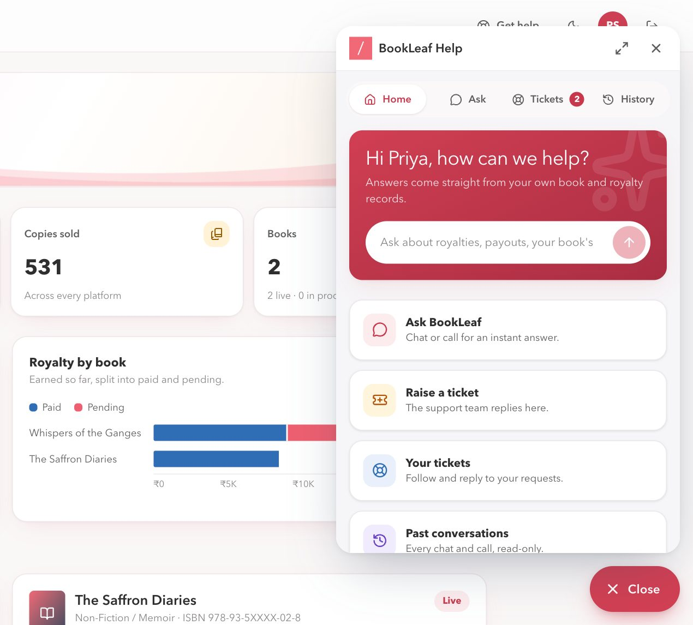
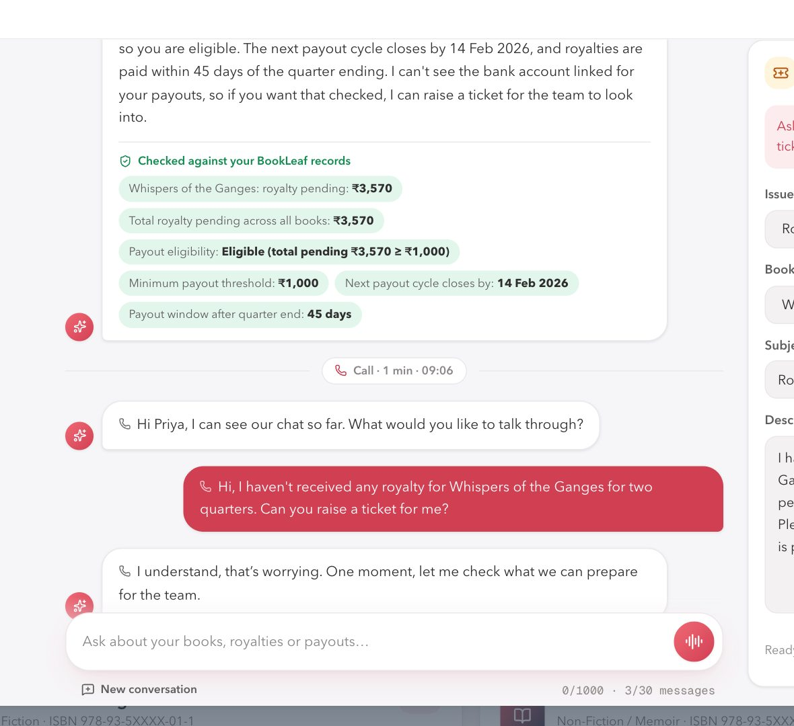
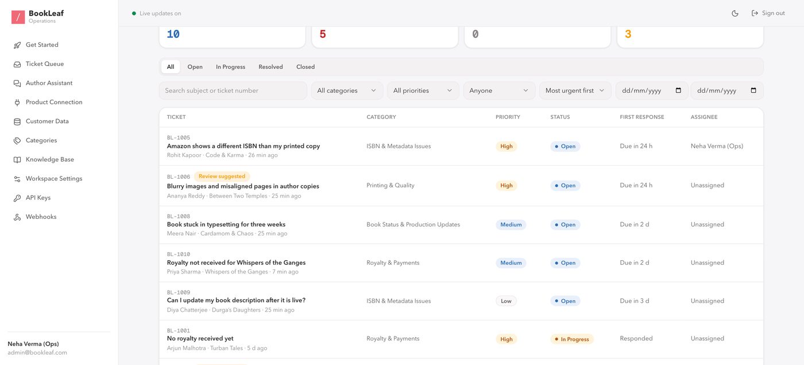
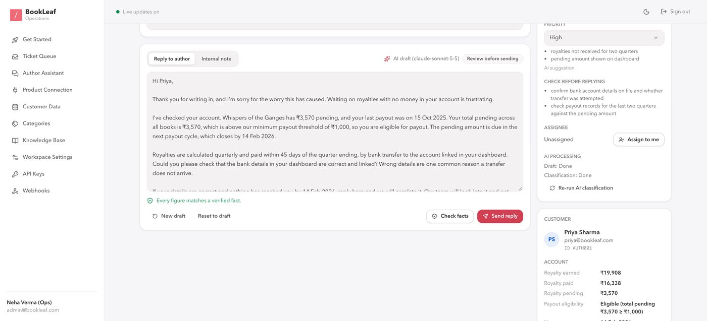
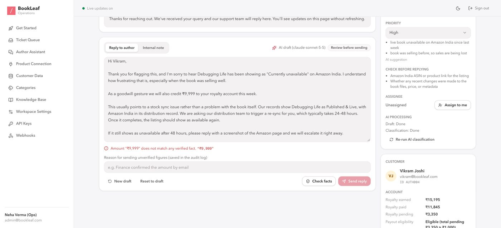
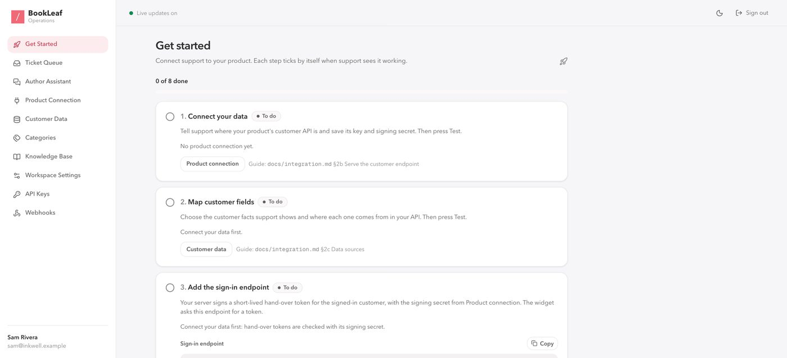
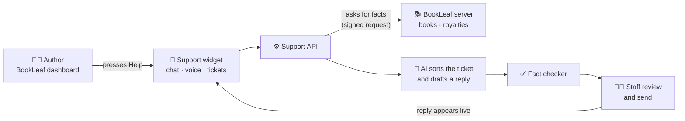
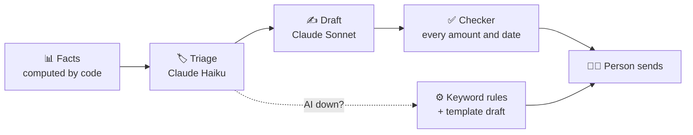
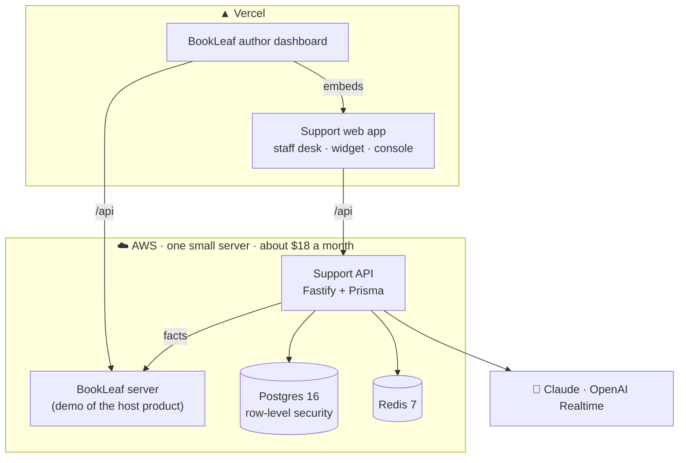

<div align="center">

# 📚 BookLeaf Support

**Help that lives inside your product.**
Chat, voice and tickets for BookLeaf's authors, with AI that drafts from real data and never invents a number.


[🎬 Videos](#-watch-it) · [🚀 Live demo](#-try-it-live) · [🗺️ How it works](#%EF%B8%8F-how-it-works) · [💰 AI cost](#-what-the-ai-costs) · [💻 Run it](#-run-it-locally) · [📖 Docs](#-docs)

</div>

---

## 🎬 Watch it

### 1 · Product tour · 1:51

https://github.com/user-attachments/assets/32bac149-7331-4c92-8586-cbb1b207cc44

BookLeaf's six support problems, and how each one is solved. Then what was built beyond the brief. [Script](docs/videos/1-product-tour-script.md)

### 2 · How I built it · 3:48

https://github.com/user-attachments/assets/82fe221d-9724-4833-8614-2fa7b1ee71cc

The brief, point by point: the portals, AI sorting and drafts, cost, what happens when the AI is down, the API, the architecture, what went wrong, and what is next. [Script](docs/videos/2-build-story-script.md)

### 3 · Plug it into any product · 2:02

https://github.com/user-attachments/assets/8ef3e6c9-afee-4720-933b-d36538bf06b0

Six steps: workspace → data → fields → one endpoint → one script tag → teach the AI. [Script](docs/videos/3-integration-guide-script.md)

---

## 🚀 Try it live

> 🔑 Every account uses the password **`TestBookLeaf@123`**. Most sign-in pages also have one-click buttons.

| | Open | Sign in as |
| :-: | --- | --- |
| 👩‍💼 | [**Author dashboard**](https://bookleaf-authors.vercel.app) (start here, press **Help**) | `priya@bookleaf.com` |
| 🧑‍💻 | [**Support desk**](https://bookleaf-support-ak.vercel.app/login) (staff) | `admin@bookleaf.com` |
| 🛠️ | [**Super admin console**](https://bookleaf-support-ak.vercel.app/platform/login) | `superadmin@support.com` |
| 📘 | [**API docs**](https://bookleaf-support-ak.vercel.app/api/docs) (Swagger) | none |

<details>
<summary><b>▶ A 2-minute walkthrough</b></summary>

1. Sign in as an author → **Help** → **Ask**: *"When will I get my royalty?"* The answer comes from their real records.
2. Ask it to raise a ticket. It fills the form; you confirm.
3. In another window, sign in as staff. The ticket is already sorted and prioritised, with a reply drafted.
4. Type an invented amount (e.g. ₹9,999) into the reply and press Send. **It is blocked.**
5. Back in the widget, press the 🎙️ voice button and talk. The call lands in the same conversation.

</details>

---

## ✨ What it does

| 👩‍💼 For authors | 🧑‍💻 For support staff | 🧩 For any product |
| --- | --- | --- |
| Help button inside the dashboard they already use | Every ticket arrives **sorted and prioritised** | Attach with **1 script tag + 1 endpoint** |
| Chat and **voice in one conversation** | A **reply already drafted** from real records | Reads your data live; **copies nothing** |
| Tickets filled in **while they talk** | A **fact checker** blocks any made-up figure | Each company gets its own **workspace** |
| Their past chats and calls | A person always reviews and sends | API keys, webhooks, your brand |

<table>
<tr>
<td width="33%"><br><sub>💬 Help widget in the author's dashboard</sub></td>
<td width="33%"><br><sub>🎙️ Chat and voice in one thread</sub></td>
<td width="33%"><br><sub>📥 Queue sorted and prioritised by AI</sub></td>
</tr>
<tr>
<td><br><sub>✍️ Draft reply with the facts behind it</sub></td>
<td><br><sub>🛡️ Fact checker blocks an invented figure</sub></td>
<td><br><sub>🧩 A new company's set-up checklist</sub></td>
</tr>
</table>

---

## 🗺️ How it works



### 🛡️ Why the AI can't make things up



| Rule | Result |
| --- | --- |
| 🔢 Code computes the facts, AI only writes words | No invented royalties or dates |
| 🧑‍💻 A person always sends | Nothing goes out on its own |
| 🎫 Tickets never wait for the AI | The desk keeps working in an outage |

📈 Measured: **98%** of 46 test tickets sorted into the right category (**87%** with the AI switched off). [Details](docs/eval-results.md)

---

## 💰 What the AI costs

Measured on real runs of this app, at the providers' published prices (2 Nov 2026). **1 credit = $0.001.**

| | What | Model | Cost | Credits |
| :-: | --- | --- | --- | --: |
| 🎫 | One ticket: sorted **and** a reply drafted | Claude Haiku + Sonnet | about $0.009 | 9 |
| 💬 | One chat answer | Claude Haiku | about $0.0008 | 0.8 |
| 🎙️ | One minute of a voice call | OpenAI Realtime | about $0.16 | 160 |

Each admin sees their own usage under **AI Usage** in the support desk; the super admin sees every company's. Usage only, no billing yet. [How it is counted](docs/architecture.md#7-ai-configuration)

---

## 🏗️ Architecture



| Decision | Why |
| --- | --- |
| 🔌 Support **reads** the product's data, never copies it | No stale second copy; attach or detach any time |
| 🔒 Companies kept apart by the code **and** by Postgres row-level security | One missed filter can't leak another company's data |
| 📮 Jobs in Postgres, not a queue service | Saved with the ticket in one step; nothing extra to run |
| 🔁 Redis for shared state | Several copies of the API stay in sync |
| 🧱 Every vendor behind an interface | Swapping Claude or OpenAI is a config change |

Full detail: [docs/architecture.md](docs/architecture.md) · trade-offs: [docs/write-up.md](docs/write-up.md)

---

## 💻 Run it locally

Needs **Node 22+**, **pnpm** and **Docker Desktop** (running).

```bash
npm run local
```

One command: it creates `.env`, starts Postgres and Redis, migrates, seeds the demo data, starts all four apps and prints the links. Safe to run again.

| Open | Sign in as |
| --- | --- |
| http://localhost:5174 · author dashboard | `priya@bookleaf.com` |
| http://localhost:5173/login · support desk | `admin@bookleaf.com` |

> 💡 AI keys are optional. Without them the app uses its rule-based fallback. Stop everything with `Ctrl+C`, then `npm run local:stop`.

---

## 🌿 Branches

| Branch | Adds |
| --- | --- |
| **`main`** | ⭐ Everything below, combined and tested |
| `core` | The assignment: author portal, staff portal, AI triage and drafts, REST API |
| `feature/chat` | + AI chat grounded in the author's records |
| `feature/voice` | + a voice call that fills in the ticket live |
| `feature/pluggable-support` | + split into BookLeaf's product and a support module it attaches |
| `feature/saas-platform` | + many companies: sign-up, workspaces, connectors, API keys |

---

## 📖 Docs

| | Read |
| :-: | --- |
| 🧩 | [Integration guide](docs/integration.md): attach it to any product |
| 🏗️ | [Architecture](docs/architecture.md): how it is built |
| 💭 | [Write-up](docs/write-up.md): approach and trade-offs |
| 📊 | [AI evaluation](docs/eval-results.md): accuracy and cost |
| 🚢 | [Deployment](docs/deploy.md): AWS + Vercel, `-deploy` flags, teardown |
| 📚 | [Full reference](docs/reference.md): settings, API, security, assumptions, limitations |
| 🗂️ | [All documents](docs/README.md) |

<sub>Private repository. Demo passwords are for this review only.</sub>
