# Architecture — BookLeaf Support

How the support module is built, and how it attaches to a host product. Diagrams are Mermaid
(they render on GitHub and in VS Code's Markdown preview). Decisions and their reasons: [`project/PLAN.md`](project/PLAN.md).
The host's side of the contract: [`integration.md`](integration.md).

---

## 1. System context

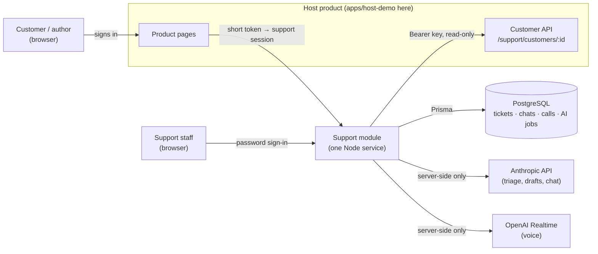

The browser never talks to an AI provider and never receives a key. Customer data is read from the
host when it is needed; support stores only reference rows (§9).

---

## 2. Runtime parts (one Node process)

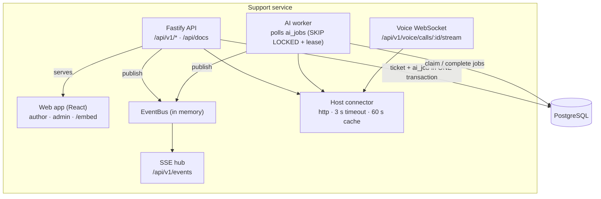

All of this is `supportPlugin` (`apps/api/src/plugin.ts`). The standalone server (`server.ts`) adds a
logger and API docs and listens on a port. A Fastify host can register the same plugin under its
own prefix instead (§15). The worker starts and stops with the plugin (`background.ts`). More than
one instance would move `EventBus` to Postgres `LISTEN/NOTIFY` (not built).

---

## 3. Layers inside the API

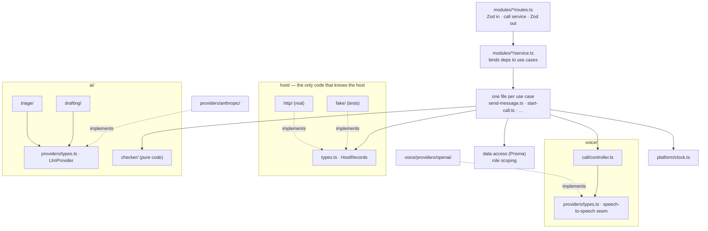

ESLint enforces the boundaries:

- Routes never import Prisma.
- Vendor SDKs are imported only inside their adapter folder.
- Core code never imports `host/http/` or `host/fake/`; `host/registry.ts` picks one from config.
- No `Date` is created outside `clock.ts`.
- Size limits: files ≤ 200 lines, functions ≤ 40 lines (components ≤ 150), complexity ≤ 10,
  nesting ≤ 3, parameters ≤ 4.

Wiring happens once, in `container.ts`.

---

## 4. Ticket lifecycle


---

## 5. AI job states, retries and recovery

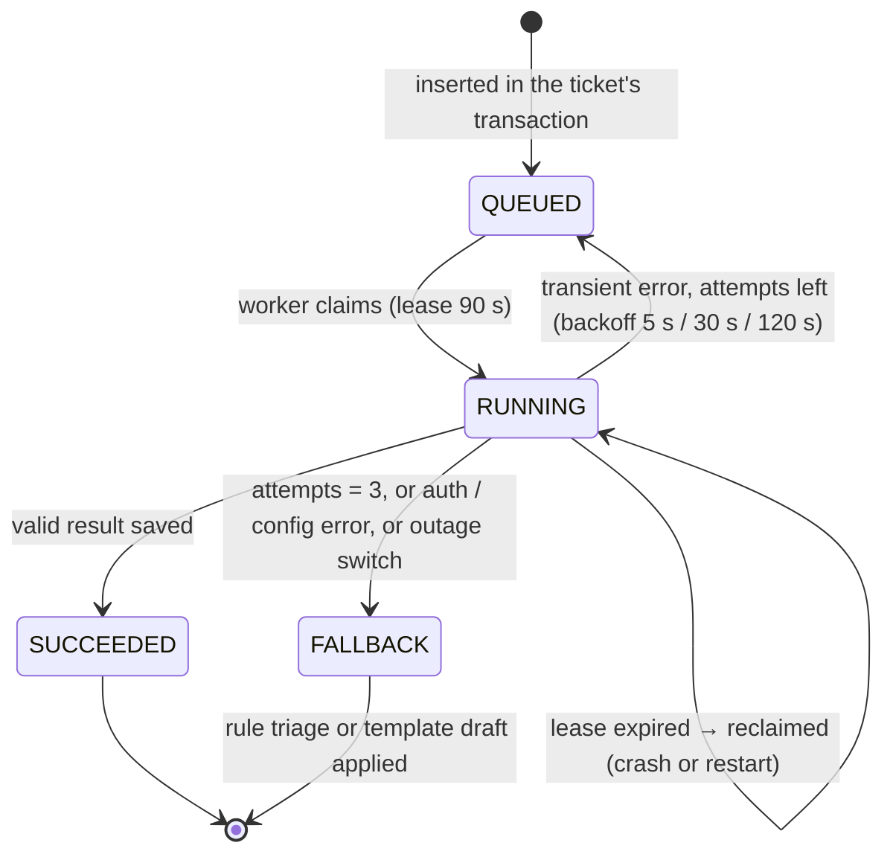

Every exit leaves the ticket with a category, a priority, an SLA and a usable draft. "Retry AI" or
"Regenerate" creates a new job with `generation + 1`; stale generations never overwrite newer results.

---

## 6. AI pipeline per job

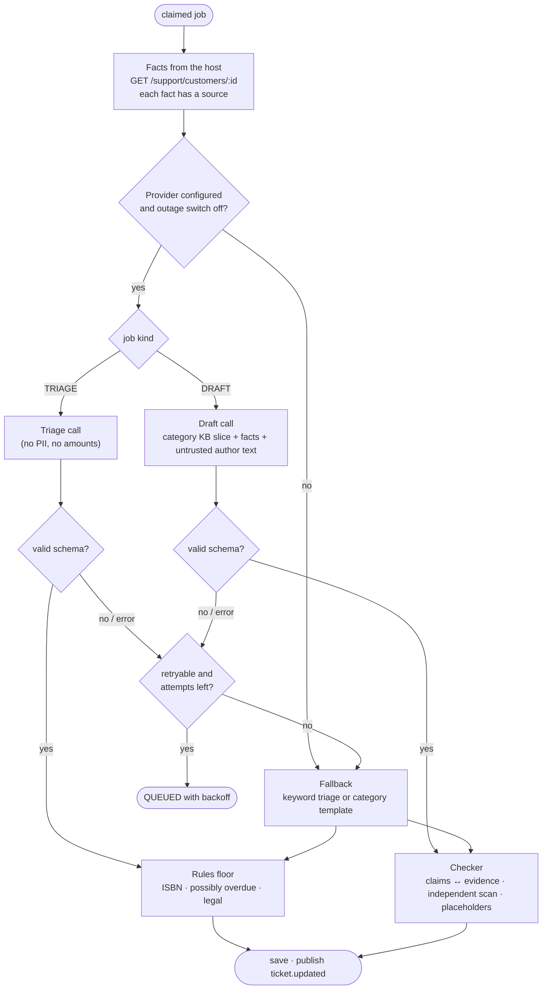

---

## 7. AI configuration

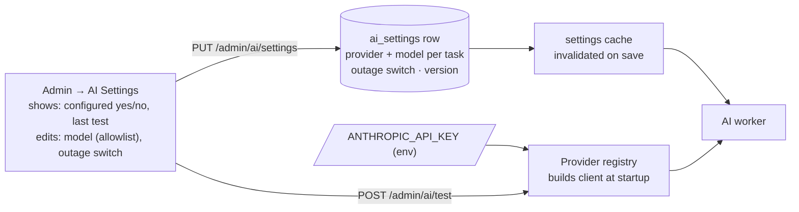

Keys come only from env. The UI can choose among providers whose key is present and models from a
server-side allowlist; it can never read or write a key.

---

## 8. Realtime and reconnection

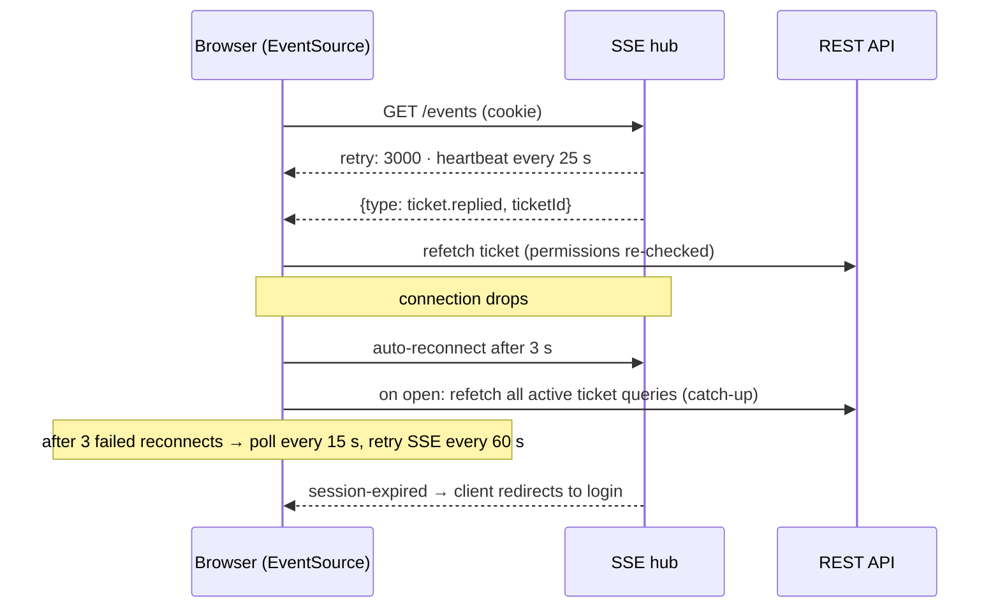

Events carry only `{ type, ticketId }`, so a missed or duplicated event cannot lose or leak data.

---

## 9. Data model

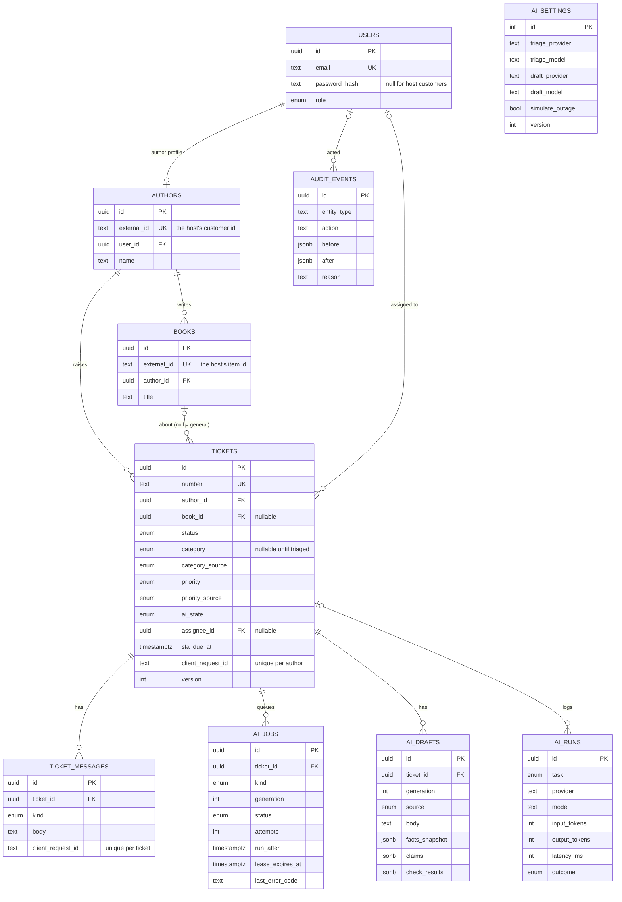

Authors and books are **reference rows**: the host owns the data, support keeps only ids, names and
titles so tickets, chats and calls can point at them. Older book columns (stage, royalties, …) are
now nullable and unused; dropping them is a later migration. Chats, calls and ticket drafts
(`chat_sessions`, `chat_messages`, `voice_sessions`, `ticket_drafts`) hang off `authors` the same way.

Indexes: `tickets (status, priority, sla_due_at)` for the queue; `tickets (author_id, created_at)`;
`ticket_messages (ticket_id, created_at)`; `ai_jobs (status, run_after)`; `books (author_id)`.
Unique: `ai_jobs (ticket_id, kind, generation)`, `tickets (author_id, client_request_id)`,
`ticket_messages (ticket_id, client_request_id)`.

---

## 10. Ticket status machine

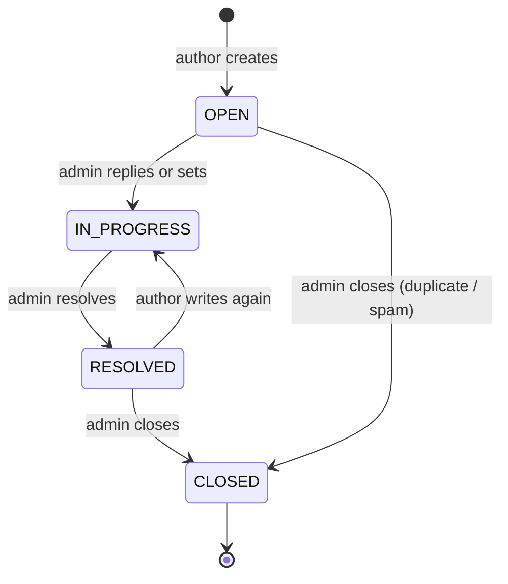

Any other transition → `409 INVALID_STATUS_TRANSITION`.

---

## 11. Access control

| Resource | Author | Admin |
| --- | --- | --- |
| Own books, tickets, public messages | read · create tickets and messages | read · write |
| Another author's books or tickets | **404** (existence not revealed) | read · write |
| Internal notes, drafts, evidence, AI status, category, priority, assignee | never in author responses or author SSE events | read · write |
| AI settings and status | 403 | read · write (no key access, ever) |

Role and author id come only from the verified session, never from a request body, a model or the
host's API. Role scoping lives in the data-access code; response
shapes are separate Zod schemas per role, so undeclared fields are stripped.

CSRF: Origin must equal `APP_ORIGIN` on state-changing requests + JSON-only bodies + a
`SameSite=Lax` cookie (`SameSite=None; Secure; Partitioned` in embed mode, §15). No CORS headers.

---

## 12. Host connection

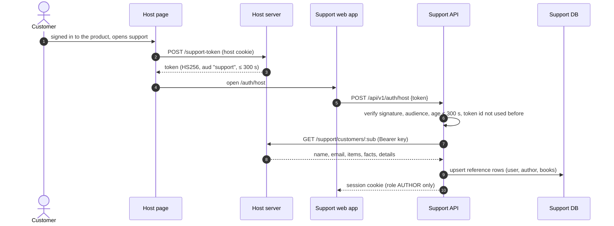

- **Facts are read live** whenever a ticket is triaged or drafted, a chat answers, a call starts, or
  *My Books* opens. One answer is cached for `HOST_CACHE_SECONDS`.
- **Host down or slow:** a typed `HostUnavailableError` becomes the single fact
  `host.records_unavailable`. The assistant does not guess: it says it could not confirm the answer
  and offers a ticket. A failure is never cached.
- **Bad data from the host:** the response is checked against `HostCustomerSchema`. Anything that
  does not match is treated as "host unavailable", not trusted.

---

## 13. AI chat

```mermaid
sequenceDiagram
    autonumber
    actor A as Author
    participant API as Chat API
    participant H as Host connector
    participant Q as Quick answers (code)
    participant LLM as LLM provider
    participant CK as Checker
    participant TD as Ticket draft

    A->>API: POST /chat/sessions/:id/messages
    API->>H: facts for this author (from the session)
    API->>Q: common question with a direct fact? (pending royalty, next payout…)
    alt quick answer
        Q-->>A: answer built from facts, no AI call
    else
        API->>LLM: system prompt + KB + facts + recent turns + current draft
        LLM-->>API: answer · fact ids used · draft change
        API->>CK: every figure in the answer vs the facts
        alt passes
            API-->>A: answer + "facts used"
        else blocked (after one retry)
            API-->>A: safe reply + offer to raise a ticket
        end
        API->>TD: apply the draft change under server rules
    end
    A->>API: POST /ticket-drafts/:id/submit (author confirms)
    API-->>A: ticket number; triage and reply draft follow as in §4
```

---

## 14. Voice calls

```mermaid
sequenceDiagram
    autonumber
    actor A as Author
    participant UI as Voice panel
    participant API as Support API
    participant H as Host connector
    participant C as Call controller
    participant M as Speech-to-speech model

    A->>UI: Start call
    UI->>API: POST /voice/calls (limits, quota, voice switched on?)
    API->>H: facts for this author
    API-->>UI: call id (must connect within a short window)
    UI->>API: WebSocket /voice/calls/:id/stream (session cookie, Origin checked; PENDING → ACTIVE once)
    API->>C: instructions with the facts, tools: draft fields + end_call
    C->>M: raw WebSocket (server-side key)
    loop the conversation
        UI->>C: microphone audio (PCM16)
        C->>M: audio
        M-->>C: audio + transcript + tool calls
        C-->>UI: audio + transcript + draft updates
    end
    C->>API: call ended (time cap, idle, hang-up or assistant ended)
    API-->>UI: transcript + ticket draft → author confirms the ticket
```

- The browser never connects to the model vendor. The key stays on the server.
- Every call has a hard time cap (`VOICE_MAX_CALL_SECONDS`, at most 300) with a spoken warning
  before it. There are per-author hourly and daily limits, and one call at a time.
- A call that ended without a ticket can be continued within 60 minutes. It joins the same thread
  and is listed once in History.

---

## 15. Embedding and the Fastify plugin

| Way to attach | What the host adds | What support does |
| --- | --- | --- |
| Link | A button that opens `/auth/host#t=…` | Normal session cookie (`SameSite=Lax`) |
| Widget | `<script src="…/embed.js" data-token-url="/support-token">` | With `HOST_ORIGINS` set: `frame-ancestors` only on `/embed` and `/embed/…`, cross-origin resource policy only on `/embed.js`, cookie `SameSite=None; Secure; Partitioned` |
| Fastify plugin | `app.register(supportPlugin, { prefix: '/support', env })` | Everything under the prefix, encapsulated: headers, cookies, rate limits, errors, worker. Under a prefix it serves the API only; the web app needs the root of an origin |

The CSRF `Origin` check is the same in every mode, so a host page can frame support but cannot post
to it. The auth guard is registered inside the `/api/v1` scope, so it covers every API route wherever
the plugin is mounted (`apps/api/test/plugin.int.test.ts` checks this under `/support`).

---

## 16. History (read-only)

`GET /conversations` merges the author's chats and call threads (one row per thread), newest first.
It pages with a `(createdAt, id)` cursor, so rows created in the same millisecond are never skipped
or repeated. Each row shows the date, a title (the ticket draft's subject, otherwise the first thing
the author said), the message count and the ticket it led to. `GET /conversations/chats/:id` and
`/conversations/calls/:id` return a read-only transcript. Another author's conversation is a 404.

---

## 17. Author screens in the widget (`apps/web`)

The author side of the support app lives under `/embed` and is meant to be framed by the host. There
is no standalone author app. Staff screens (`/login`, `/admin`, `/admin/ai`, `/admin/assistant`) are
normal pages. Old author paths (`/books`, `/assistant`, `/tickets`, `/history`) redirect to the
matching `/embed` screen. The books page was removed: books live on the host's own dashboard.

The Ask screen is built from small parts:

```text
AssistantPage
└── ChatPanel                       organisms/ChatPanel.tsx   the conversation and its state
    ├── ChatThread                  typed and spoken lines, saved thread + live call lines
    │   └── uses lib/callGroups.ts  groups lines into "Call · N min" dividers
    └── ChatFooter                  the bottom of the screen: one of three things
        ├── ChatComposer            type, or press the voice button
        ├── ChatCallBar             while a call is live (waveform, mute, hang up, timer)
        └── LimitReached            the message limit card with "New conversation"
```

| File | Job |
| --- | --- |
| `lib/callGroups.ts` | Turns a list of messages into thread items. A message that has a `callId` belongs to a call. Lines of one call get one divider that shows the minutes between its first and last line (at least 1) |
| `lib/voice/liveLines.ts` | Chooses which live call lines to show. Lines of the current call show until the saved chat contains a message with that `callId` (the server saves them when the call ends), so nothing shows twice or disappears |
| `lib/useCallInChat.ts` | Starts a call inside the current chat. If there is no chat yet, it starts one first, then calls `POST /voice/calls` with its `chatSessionId` |
| `lib/ticketVisibility.ts` | The ticket box shows only when there is something to show (a draft with content, one awaiting confirmation, one sent, or one the author opened). A blank "Not sent" box is never shown |

`ChatFooter` counts the limit as saved turns plus queued messages. When the count reaches
`maxTurns`, the composer is replaced by `LimitReached`. `maxTurns` comes from the server with the
chat session.

---

## 18. Calls inside a chat

A call can be started from a chat. It then shares that chat's conversation, its ticket draft and its
message limit. This is the only way the Ask screen starts a call.

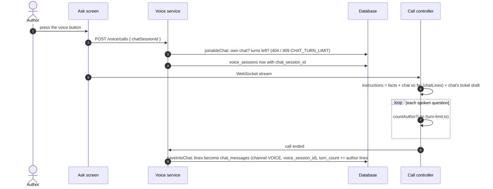

**Modules**

| File | Job |
| --- | --- |
| `modules/voice/chat-link.ts` | `joinableChat` (the author's own chat with turns left, else 404 or 409), `chatLines` (the chat so far, typed and spoken, as call lines), `turnsLeft` (turns the chat has left, or null when the call is not in a chat), `saveIntoChat` (writes the call's lines into the chat when it ends and adds the author's lines to `turn_count`) |
| `voice/call/turn-limit.ts` | `countAuthorTurn` counts spoken author lines against the turns left. On the last allowed one it arms the limit: the answer is still given, then `sayLimitGoodbye` speaks the goodbye and ends the call with reason `TURN_LIMIT`. A 25 second timer ends the call anyway if that does not finish |
| `modules/voice/start-call.ts` · `call-setup.ts` | A call in a chat is always a new thread (`resume` is ignored): the chat already holds the earlier conversation. Starting is one transaction under an author lock |
| `modules/chat/limit.ts` | The one `CHAT_TURN_LIMIT` (409) error used by chat and by starting a call |

**Data** (migration `20261028090000_call_in_chat`, additive only)

| Change | Detail |
| --- | --- |
| `ChatChannel` enum | `CHAT`, `VOICE` |
| `chat_messages.channel` | `NOT NULL DEFAULT 'CHAT'` (existing rows become `CHAT` with no rewrite problem) |
| `chat_messages.voice_session_id` | Nullable UUID, foreign key to `voice_sessions`, `ON DELETE SET NULL` |
| `voice_sessions.chat_session_id` | Nullable UUID, foreign key to `chat_sessions`, `ON DELETE SET NULL`, with an index |
| `VoiceEndReason.TURN_LIMIT` | New enum value: the conversation reached its message limit during the call |

**History.** A call that has a `chat_session_id` is not listed again on its own: it appears inside
its chat (`modules/conversations/calls.ts` skips calls with a chat).

**One limit.** `chat_sessions.turn_count` is shared. A typed message adds 1. Each author line from
a call adds 1 when the call is saved. At the start of a call, `turnsLeft` is computed from the same
count, so a call cannot give an author more messages than a chat would.

---

## 19. Voice persona

`voice/call/persona.ts` and `persona-text.ts` decide how the assistant sounds. `instructions.ts`
adds the facts rules on top.

- `VOICE_STYLE` is `hinglish` (default) or `english` (`config/voice.ts`).
- `persona-text.ts` holds two persona texts, `HINGLISH_PERSONA` and `ENGLISH_PERSONA`. Each has
  sections: personality, language, emotion and tone, pacing, fillers, variety and unclear audio
  (the structure OpenAI recommends for realtime prompts). The Hinglish persona is warm and polite:
  it uses "aap" and "ji", mirrors the author's mix of Hindi and English, and says amounts, dates and
  ids in English words exactly as in the verified facts.
- `persona.ts` also holds the fixed spoken lines per style: the greeting (three kinds: new,
  resumed, and "chat" for a call that joins a chat), the 30 second time warning, and the goodbye
  for the message limit. The greeting is fixed text with the author's first name, because a
  free-form greeting once said "Hi, Author".
- **Transcription language.** `transcriptionLanguage(style)` returns `null` for Hinglish, so the
  speech service detects the language itself and does not force Hindi words into English
  spellings. For `english` it returns `"en"`.

---

## 20. Widget theme

The widget follows the host page's light or dark theme. There are two parts.

1. **The frame around the app** (`apps/web/public/embed.js`). `currentTheme()` picks the theme from
   the tag's `data-theme` (`light`, `dark`, or `auto`). In `auto` it reads `<html>` (class `dark`
   or `light`, or `data-theme`), else `prefers-color-scheme`. `paint()` sets CSS variables
   (`--bl-panel`, `--bl-bg`, `--bl-line`, `--bl-ink`, …) on the launcher and the panel. A
   `MutationObserver` on `<html>` and the system setting call `repaint()`.
2. **The app inside the frame** (`apps/web/src/lib/hostTheme.ts`, called from `main.tsx` when the
   page is framed). `embed.js` puts the theme in the frame address (`#t=…&theme=dark`) and sends
   `{ type: "bookleaf-support:theme", theme }` to the frame on every change. `followHostTheme`
   reads the address first, then listens for messages, accepting only the parent window and only
   `light` or `dark`. It calls `showTheme`, which restyles the app **without saving** the choice, so
   a visitor's own saved theme for the standalone app is not overwritten.

Colours in `embed.js` are kept equal to the support app's tokens (`apps/web/src/styles/tokens.css`).

