# Architecture — BookLeaf Support

How the support module is built, and how it attaches to a host product. Diagrams are Mermaid
(they render on GitHub and in VS Code's Markdown preview). Decisions and their reasons: [`project/PLAN.md`](project/PLAN.md).
The host's side of the contract: [`integration.md`](integration.md).

---

## 1. System context

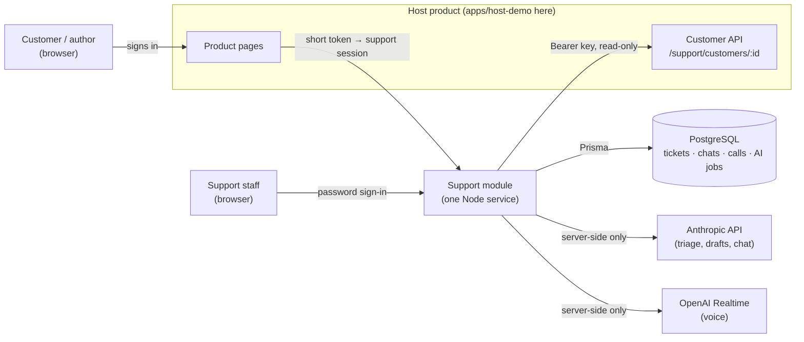

The browser never talks to an AI provider and never receives a key. Customer data is read from the
host when it is needed; support stores only reference rows (§9).

---

## 2. Runtime parts (one Node process per copy)

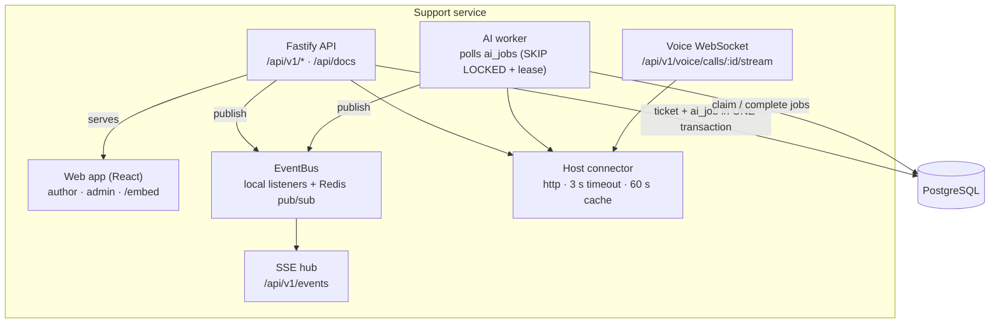

All of this is `supportPlugin` (`apps/api/src/plugin.ts`). The standalone server (`server.ts`) adds a
logger and API docs and listens on a port. A Fastify host can register the same plugin under its
own prefix instead (§15). The worker starts and stops with the plugin (`background.ts`). Several
copies can run side by side: everything they must share (events, rate limits, one-use tokens,
the chat queue, settings-cache clearing) goes through Redis (§21).

---

## 3. Layers inside the API

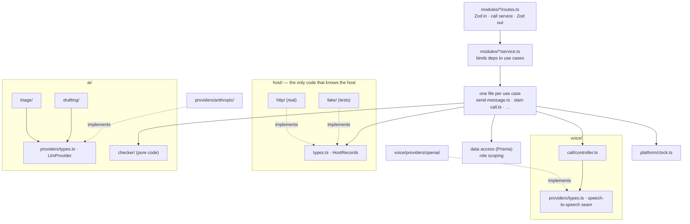

ESLint enforces the boundaries:

- Routes never import Prisma.
- Vendor SDKs are imported only inside their adapter folder.
- Core code never imports `host/http/` or `host/fake/`; `host/registry.ts` picks one from config.
- No `Date` is created outside `clock.ts`.
- Size limits: files ≤ 200 lines, functions ≤ 40 lines (components ≤ 150), complexity ≤ 10,
  nesting ≤ 3, parameters ≤ 4.

Wiring happens once, in `container.ts`.

---

## 4. Ticket lifecycle

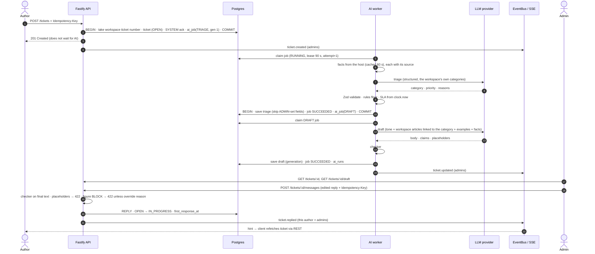

---

## 5. AI job states, retries and recovery

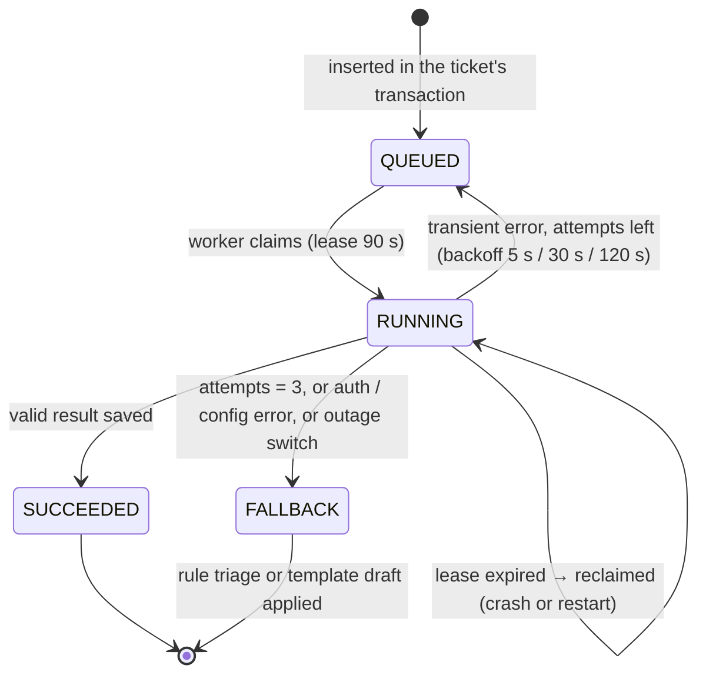

Every exit leaves the ticket with a category, a priority, an SLA and a usable draft. "Retry AI" or
"Regenerate" creates a new job with `generation + 1`; stale generations never overwrite newer results.

---

## 6. AI pipeline per job

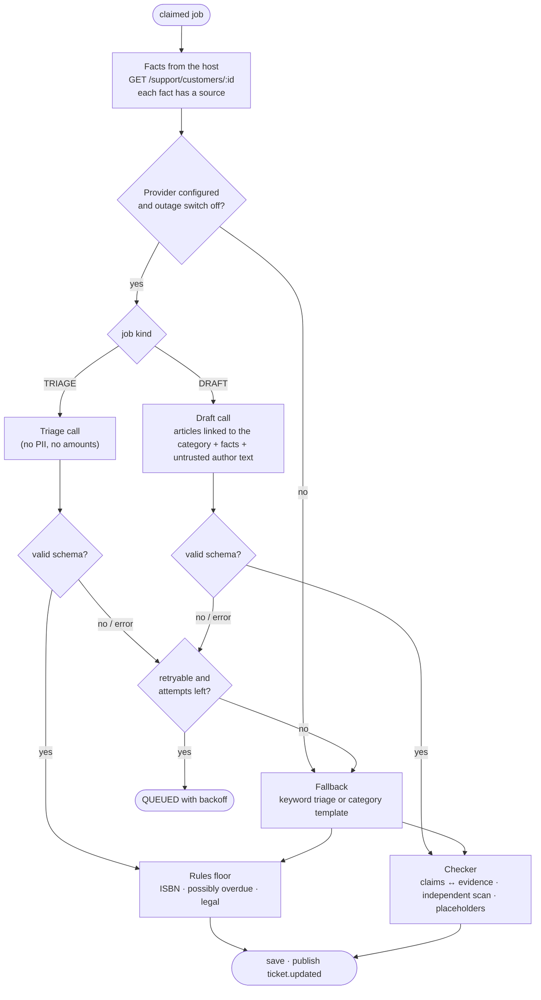

---

## 7. AI configuration

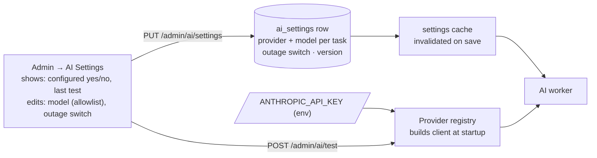

Keys come only from env. The UI can choose among providers whose key is present and models from a
server-side allowlist; it can never read or write a key.

---

## 8. Realtime and reconnection

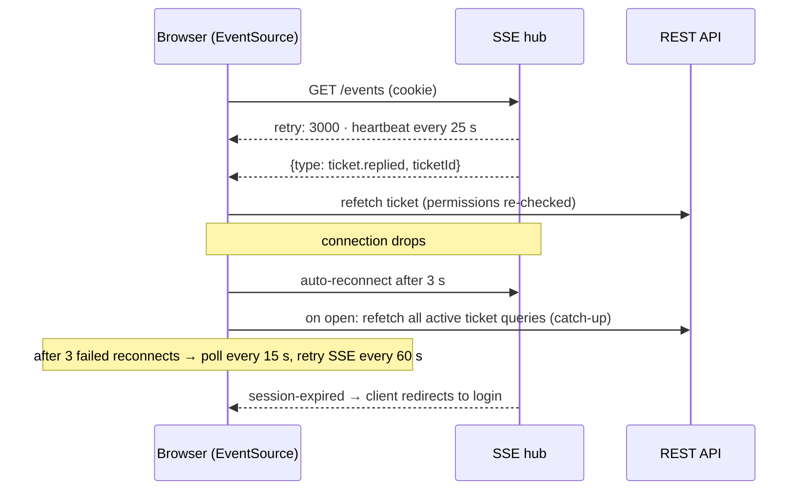

Events carry only `{ type, ticketId }`, so a missed or duplicated event cannot lose or leak data.

---

## 9. Data model

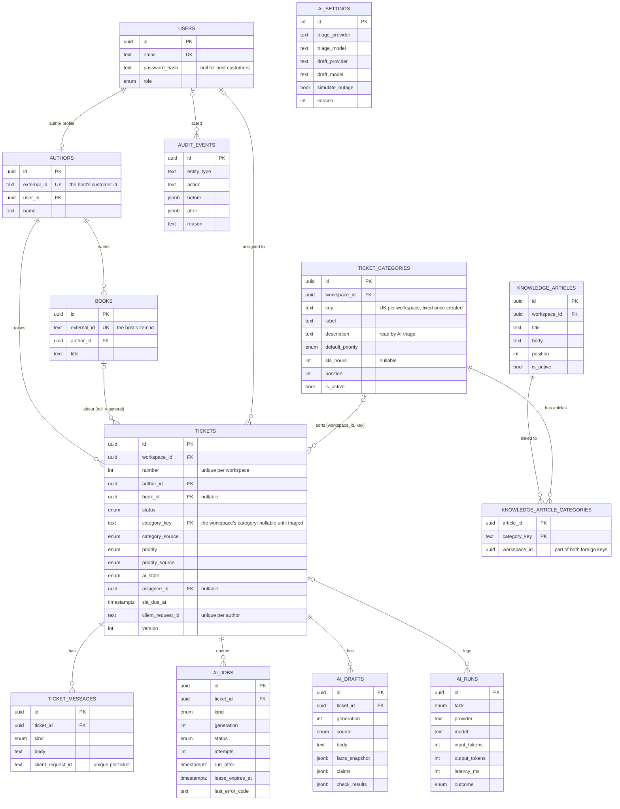

Authors and books are **reference rows**: the host owns the data, support keeps only ids, names and
titles so tickets, chats and calls can point at them. Older book columns (stage, royalties, …) are
now nullable and unused; dropping them is a later migration. Chats, calls and ticket drafts
(`chat_sessions`, `chat_messages`, `voice_sessions`, `ticket_drafts`) hang off `authors` the same way.

Indexes: `tickets (status, priority, sla_due_at)` for the queue; `tickets (author_id, created_at)`;
`ticket_messages (ticket_id, created_at)`; `ai_jobs (status, run_after)`; `books (author_id)`.
Unique: `ai_jobs (ticket_id, kind, generation)`, `tickets (author_id, client_request_id)`,
`tickets (workspace_id, number)`, `ticket_messages (ticket_id, client_request_id)`,
`workspaces (ticket_prefix)`.

**Ticket numbers (F-13).** Each workspace numbers its own tickets. `workspaces.next_ticket_number`
starts at 1001; a ticket insert takes it with `UPDATE workspaces SET next_ticket_number =
next_ticket_number + 1 … RETURNING` inside the ticket's own transaction, so the row lock rules out
duplicates and a rollback leaves no gap (`apps/api/src/modules/tickets/numbering.ts`). The label is
`${ticket_prefix}-${number}` (BL-1001). The prefix is made once at sign-up from the company name
(initials, or the capitals of a one-word name; 2–5 letters; fallback `TKT`) and never changes. It is
unique across the platform: a taken base gets the first free number (BL → BL2 → BL3), and a
concurrent sign-up that loses the race retries with the next one
(`apps/api/src/modules/workspaces/ticket-prefix.ts`). The number is a label only: the UUID is the
identity, and a search by number only looks inside the signed-in workspace.

---

## 10. Ticket status machine

Source: `apps/api/src/modules/tickets/status-machine.ts`. The test is
`apps/api/test/tickets.int.test.ts` ("refuses an invalid status transition").

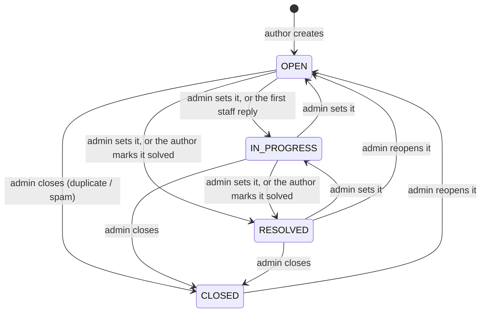

**CLOSED is not a final state.** The code allows `CLOSED → OPEN`. Nothing else leaves CLOSED.

Allowed admin changes (`TRANSITIONS`). Any other change is refused with `409` and the code
`INVALID_TRANSITION`. Setting a ticket to the status it already has is accepted and changes nothing.

| From | Admin may move it to |
| --- | --- |
| OPEN | IN_PROGRESS, RESOLVED, CLOSED |
| IN_PROGRESS | OPEN, RESOLVED, CLOSED |
| RESOLVED | IN_PROGRESS, CLOSED, OPEN |
| CLOSED | OPEN |

Changes that do not come from the admin status field:

- **First staff reply.** A reply sent on an `OPEN` ticket moves it to `IN_PROGRESS`. A reply on any
  other status leaves the status as it is (`modules/messages/record-reply.ts`, `recordReply`; it reads
  the status inside the write, so a ticket the author solved a moment earlier stays `RESOLVED`).
- **Solved locks the ticket for the author (U-2).** A `RESOLVED` or `CLOSED` ticket refuses author
  messages with `409 TICKET_SOLVED` (`modules/messages/author-message.ts`; the status is checked again
  inside the write, so a ticket solved a moment earlier never takes the message). The author view
  carries `canReply: false` and the widget shows "Raise a new ticket" instead of the reply box. Only
  staff can reopen it (status field above); staff replies are still allowed. This replaced the old
  "author writes again → OPEN" rule, which caused the live bug where BL-1001 went back to Open after
  the author marked it solved and then typed "hey". Tests: `apps/api/test/ticket-solved-lock.int.test.ts`.
- **Author marks it solved.** `POST /tickets/:id/solve` moves an `OPEN` or `IN_PROGRESS` ticket to
  `RESOLVED` (`modules/tickets/solve.ts`). On a `RESOLVED` or `CLOSED` ticket it answers `409
  ALREADY_SOLVED`. Test: `apps/api/test/author-tickets.int.test.ts`.

---

## 11. Access control

| Resource | Author | Admin |
| --- | --- | --- |
| Own books, tickets, public messages | read · create tickets and messages | read · write |
| Another author's books or tickets | **404** (existence not revealed) | read · write |
| Internal notes, drafts, evidence, AI status, category, priority, assignee | never in author responses or author SSE events | read · write |
| AI settings and status | 403 | read · write (no key access, ever) |

Role and author id come only from the verified session, never from a request body, a model or the
host's API. Role scoping lives in the data-access code; response
shapes are separate Zod schemas per role, so undeclared fields are stripped.

**Staff sign-in (F-12).** A staff email has one account on the whole platform:
`users.login_email` (trimmed, lowercased, unique) is set only for password accounts, and
`POST /auth/login` reads exactly that one account. Sign-up refuses an email that already has an
account (409 `EMAIL_TAKEN`). Authors keep `login_email` NULL, so one author email can exist in
several workspaces.

**Ending sessions early (F-12).** The session cookie is a signed token that carries the user's
`users.session_version` (claim `sv`). The auth guard, the live-updates heartbeat and the voice
socket (when it signs in with the cookie; its one-time 60 s ticket is issued from a checked session) check it against the current value on every request (one primary-key read, no cache), and
a token with another version gets 401. The version is bumped by logout (in the app; only if the
token's version is still current, so an old cookie cannot sign out newer sessions), by a change of
`password_hash` and by deleting a `workspace_members` row (both through database triggers, so any
code path or manual SQL counts). Logout therefore signs the user out on every device. There is no
per-device session table. Tokens issued before this change have no version and are refused once.

**Workspaces in the database (S.8).** Postgres row-level security is the second lock behind the
data-access code's own `workspace_id` filters. Every tenant table has a `workspace_isolation`
policy (RLS + FORCE); child tables follow their parent row. The API serves requests as a
restricted role (`DATABASE_URL`, no `BYPASSRLS`): the auth guard runs the handler inside
`withWorkspace(session.workspaceId)`, and each query sets `app.workspace_id` for its own
transaction first, so a query without a workspace filter still sees only that workspace. Work that
is not one workspace's (sign-in lookups by email, slug or API key, signup, the AI worker, the
webhook sender, the startup call clean-up) runs in `asPlatform()` on the owner
(`DATABASE_ADMIN_URL`). Code with no scope sees no tenant rows. Details: `docs/saas/PLAN.md` §5.2.

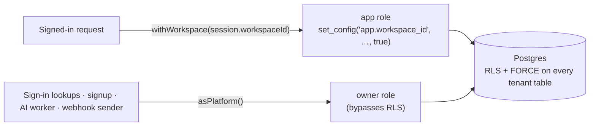

CSRF: Origin must equal `APP_ORIGIN` on state-changing requests + JSON-only bodies + a
`SameSite=Lax` cookie (`SameSite=None; Secure; Partitioned` in embed mode, §15). No CORS headers.

---

## 12. Host connection

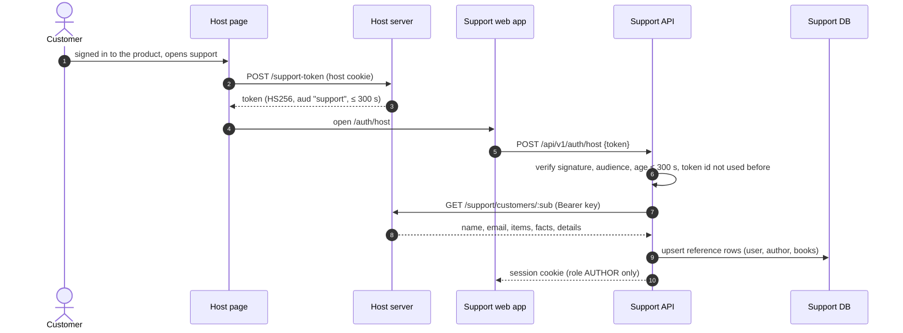

- **Facts are read live** whenever a ticket is triaged or drafted, a chat answers, a call starts, or
  *My Books* opens. One answer is cached for `HOST_CACHE_SECONDS`.
- **Host down or slow:** a typed `HostUnavailableError` becomes the single fact
  `host.records_unavailable`. The assistant does not guess: it says it could not confirm the answer
  and offers a ticket. A failure is never cached.
- **Bad data from the host:** the response is checked against `HostCustomerSchema`. Anything that
  does not match is treated as "host unavailable", not trusted.

---

## 13. AI chat

```mermaid
sequenceDiagram
    autonumber
    actor A as Author
    participant API as Chat API
    participant H as Host connector
    participant Q as Quick answers (code)
    participant LLM as LLM provider
    participant CK as Checker
    participant TD as Ticket draft

    A->>API: POST /chat/sessions/:id/messages
    API->>H: facts for this author (from the session)
    API->>Q: common question with a direct fact? (pending royalty, next payout…)
    alt quick answer
        Q-->>A: answer built from facts, no AI call
    else
        API->>LLM: system prompt + KB + facts + recent turns + current draft
        LLM-->>API: answer · fact ids used · draft change
        API->>CK: every figure in the answer vs the facts
        alt passes
            API-->>A: answer + "facts used"
        else blocked (after one retry)
            API-->>A: safe reply + offer to raise a ticket
        end
        API->>TD: apply the draft change under server rules
    end
    A->>API: POST /ticket-drafts/:id/submit (author confirms)
    API-->>A: ticket number; triage and reply draft follow as in §4
```

---

## 14. Voice calls

```mermaid
sequenceDiagram
    autonumber
    actor A as Author
    participant UI as Voice panel
    participant API as Support API
    participant H as Host connector
    participant C as Call controller
    participant M as Speech-to-speech model

    A->>UI: Start call
    UI->>API: POST /voice/calls (limits, quota, voice switched on?)
    API->>H: facts for this author
    API-->>UI: call id (must connect within a short window)
    UI->>API: WebSocket /voice/calls/:id/stream (session cookie, Origin checked; PENDING → ACTIVE once)
    API->>C: instructions with the facts, tools: draft fields + end_call
    C->>M: raw WebSocket (server-side key)
    loop the conversation
        UI->>C: microphone audio (PCM16)
        C->>M: audio
        M-->>C: audio + transcript + tool calls
        C-->>UI: audio + transcript + draft updates
    end
    C->>API: call ended (time cap, idle, hang-up or assistant ended)
    API-->>UI: transcript + ticket draft → author confirms the ticket
```

- The browser never connects to the model vendor. The key stays on the server.
- Every call has a hard time cap (`VOICE_MAX_CALL_SECONDS`, at most 300) with a spoken warning
  before it. There are per-author hourly and daily limits, and one call at a time.
- A call that ended without a ticket can be continued within 60 minutes. It joins the same thread
  and is listed once in History.

---

## 15. Embedding and the Fastify plugin

| Way to attach | What the host adds | What support does |
| --- | --- | --- |
| Link | A button that opens `/auth/host#t=…` | Normal session cookie (`SameSite=Lax`) |
| Widget | `<script src="…/embed.js" data-workspace="bookleaf" data-token-url="/support-token">` | In embed mode: `frame-ancestors` only on `/embed/<slug>` and its pages, listing only that workspace's origins (`HOST_ORIGINS` counts for BookLeaf only; unknown slug 404; old `/embed` redirects to `/embed/bookleaf`), cross-origin resource policy only on `/embed.js`, cookie `SameSite=None; Secure; Partitioned`. The host token must be for the slug's workspace (else 403) |
| Fastify plugin | `app.register(supportPlugin, { prefix: '/support', env })` | Everything under the prefix, encapsulated: headers, cookies, rate limits, errors, worker. Under a prefix it serves the API only; the web app needs the root of an origin |

The CSRF `Origin` check is the same in every mode, so a host page can frame support but cannot post
to it. The auth guard is registered inside the `/api/v1` scope, so it covers every API route wherever
the plugin is mounted (`apps/api/test/plugin.int.test.ts` checks this under `/support`).

---

## 16. History (read-only)

`GET /conversations` merges the author's chats and call threads (one row per thread), newest first.
It pages with a `(createdAt, id)` cursor, so rows created in the same millisecond are never skipped
or repeated. Each row shows the date, a title (the ticket draft's subject, otherwise the first thing
the author said), the message count and the ticket it led to. `GET /conversations/chats/:id` and
`/conversations/calls/:id` return a read-only transcript. Another author's conversation is a 404.

---

## 17. Author screens in the widget (`apps/web`)

The author side of the support app lives under `/embed/<workspace slug>` (one address per workspace,
F-18) and is meant to be framed by the host. There is no standalone author app. Staff screens
(`/login`, `/admin`, `/admin/ai`, `/admin/assistant`) are normal pages. Old author paths (`/books`,
`/assistant`, `/tickets`, `/history`) and the old shared `/embed/…` addresses redirect to the
matching screen under `/embed/bookleaf`. Links inside the app come from `useAuthorPaths()`
(`apps/web/src/lib/paths.ts`), which reads the slug from the address. The books page was removed: books live on the host's own dashboard.

The Ask screen is built from small parts:

```text
AssistantPage
└── ChatPanel                       organisms/ChatPanel.tsx   the conversation and its state
    ├── ChatThread                  typed and spoken lines, saved thread + live call lines
    │   └── uses lib/callGroups.ts  groups lines into "Call · N min" dividers
    └── ChatFooter                  the bottom of the screen: one of three things
        ├── ChatComposer            type, or press the voice button
        ├── ChatCallBar             while a call is live (waveform, mute, hang up, timer)
        └── LimitReached            the message limit card with "New conversation"
```

| File | Job |
| --- | --- |
| `lib/callGroups.ts` | Turns a list of messages into thread items. A message that has a `callId` belongs to a call. Lines of one call get one divider that shows the minutes between its first and last line (at least 1) |
| `lib/voice/liveLines.ts` | Chooses which live call lines to show. Lines of the current call show until the saved chat contains a message with that `callId` (the server saves them when the call ends), so nothing shows twice or disappears |
| `lib/useCallInChat.ts` | Starts a call inside the current chat. If there is no chat yet, it starts one first, then calls `POST /voice/calls` with its `chatSessionId` |
| `lib/ticketVisibility.ts` | The ticket box shows only when there is something to show (a draft with content, one awaiting confirmation, one sent, or one the author opened). A blank "Not sent" box is never shown |

`ChatFooter` counts the limit as saved turns plus queued messages. When the count reaches
`maxTurns`, the composer is replaced by `LimitReached`. `maxTurns` comes from the server with the
chat session.

---

## 18. Calls inside a chat

A call can be started from a chat. It then shares that chat's conversation, its ticket draft and its
message limit. This is the only way the Ask screen starts a call.

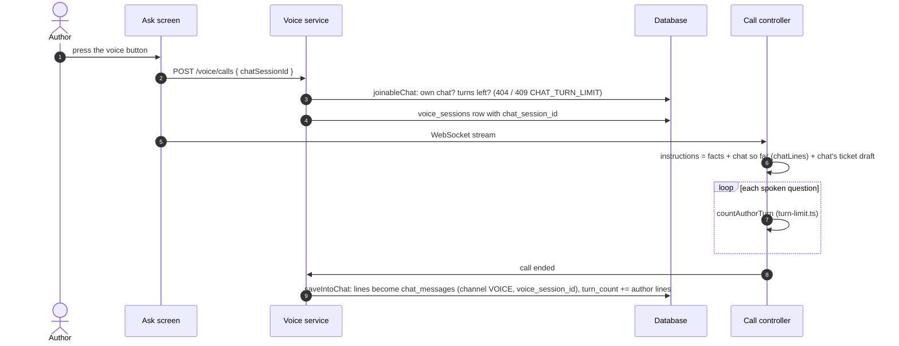

**Modules**

| File | Job |
| --- | --- |
| `modules/voice/chat-link.ts` | `joinableChat` (the author's own chat with turns left, else 404 or 409), `chatLines` (the chat so far, typed and spoken, as call lines), `turnsLeft` (turns the chat has left, or null when the call is not in a chat), `saveIntoChat` (writes the call's lines into the chat when it ends and adds the author's lines to `turn_count`) |
| `voice/call/turn-limit.ts` | `countAuthorTurn` counts spoken author lines against the turns left. On the last allowed one it arms the limit: the answer is still given, then `sayLimitGoodbye` speaks the goodbye and ends the call with reason `TURN_LIMIT`. A 25 second timer ends the call anyway if that does not finish |
| `modules/voice/start-call.ts` · `call-setup.ts` | A call in a chat is always a new thread (`resume` is ignored): the chat already holds the earlier conversation. Starting is one transaction under an author lock |
| `modules/chat/limit.ts` | The one `CHAT_TURN_LIMIT` (409) error used by chat and by starting a call |

**Data** (migration `20261028090000_call_in_chat`, additive only)

| Change | Detail |
| --- | --- |
| `ChatChannel` enum | `CHAT`, `VOICE` |
| `chat_messages.channel` | `NOT NULL DEFAULT 'CHAT'` (existing rows become `CHAT` with no rewrite problem) |
| `chat_messages.voice_session_id` | Nullable UUID, foreign key to `voice_sessions`, `ON DELETE SET NULL` |
| `voice_sessions.chat_session_id` | Nullable UUID, foreign key to `chat_sessions`, `ON DELETE SET NULL`, with an index |
| `VoiceEndReason.TURN_LIMIT` | New enum value: the conversation reached its message limit during the call |

**History.** A call that has a `chat_session_id` is not listed again on its own: it appears inside
its chat (`modules/conversations/calls.ts` skips calls with a chat).

**One limit.** `chat_sessions.turn_count` is shared. A typed message adds 1. Each author line from
a call adds 1 when the call is saved. At the start of a call, `turnsLeft` is computed from the same
count, so a call cannot give an author more messages than a chat would.

---

## 19. Voice persona

`voice/call/persona.ts` and `persona-text.ts` decide how the assistant sounds. `instructions.ts`
adds the facts rules on top.

- `VOICE_STYLE` is `hinglish` (default) or `english` (`config/voice.ts`).
- `persona-text.ts` holds two persona texts, `HINGLISH_PERSONA` and `ENGLISH_PERSONA`. Each has
  sections: personality, language, emotion and tone, pacing, fillers, variety and unclear audio
  (the structure OpenAI recommends for realtime prompts). The Hinglish persona is warm and polite:
  it uses "aap" and "ji", mirrors the author's mix of Hindi and English, and says amounts, dates and
  ids in English words exactly as in the verified facts.
- `persona.ts` also holds the fixed spoken lines per style: the greeting (three kinds: new,
  resumed, and "chat" for a call that joins a chat), the 30 second time warning, and the goodbye
  for the message limit. The greeting is fixed text with the author's first name, because a
  free-form greeting once said "Hi, Author".
- **Transcription language.** `transcriptionLanguage(style)` returns `null` for Hinglish, so the
  speech service detects the language itself and does not force Hindi words into English
  spellings. For `english` it returns `"en"`.

---

## 20. Widget theme

The widget follows the host page's light or dark theme. There are two parts.

1. **The frame around the app** (`apps/web/public/embed.js`). `currentTheme()` picks the theme from
   the tag's `data-theme` (`light`, `dark`, or `auto`). In `auto` it reads `<html>` (class `dark`
   or `light`, or `data-theme`), else `prefers-color-scheme`. `paint()` sets CSS variables
   (`--bl-panel`, `--bl-bg`, `--bl-line`, `--bl-ink`, …) on the launcher and the panel. A
   `MutationObserver` on `<html>` and the system setting call `repaint()`.
2. **The app inside the frame** (`apps/web/src/lib/hostTheme.ts`, called from `main.tsx` when the
   page is framed). `embed.js` puts the theme in the frame address (`#t=…&theme=dark`) and sends
   `{ type: "bookleaf-support:theme", theme }` to the frame on every change. `followHostTheme`
   reads the address first, then listens for messages, accepting only the parent window and only
   `light` or `dark`. It calls `showTheme`, which restyles the app **without saving** the choice, so
   a visitor's own saved theme for the standalone app is not overwritten.

Colours in `embed.js` are kept equal to the support app's tokens (`apps/web/src/styles/tokens.css`).

---

## 21. Running more than one instance

Since F-19 (2026-10-30) the API can run as **several copies** behind a load balancer. Postgres holds
the data; **Redis** holds the small pieces of state every copy must see the same way. Each piece sits
behind a small interface in `apps/api/src/platform/shared-state/` (CLAUDE.md §21): `types.ts` is the
only thing the rest of the code imports, `registry.ts` picks the backend once at startup, and the
Redis client (`ioredis`) is imported only in `shared-state/redis/` (a lint rule checks this).

| Shared state | Interface | Redis | Where it is used |
| --- | --- | --- | --- |
| Live ticket events behind Server-Sent Events | `PubSub` + `sharedChannel` | pub/sub channel `ticket-events` | `platform/event-bus.ts` (`sharedEventBus`) |
| Live draft changes for a call (author edits on any copy reach the call's copy) | `PubSub` + `sharedChannel` | channel `draft-changes` | `modules/ticket-drafts/live.ts` |
| One-use token ids: host sign-in tokens and voice call tickets | `OneTimeClaims` | `SET key 1 NX EX <seconds left>` | `modules/auth/used-tokens.ts` |
| Every `@fastify/rate-limit` limit (sign-in, sign-up, chat, voice, tickets, drafts, server API) | `RateCounters` | `INCR` + `PEXPIRE` in one Lua script (fixed window) | `platform/http/rate-limit-store.ts` |
| Chat: one conversation answered in order, at most 3 waiting | `KeyedQueues` | a first-come, first-served line per key (Lua: tail, head, lease) | `modules/chat/service.ts` |
| Settings caches: workspace settings (5 s), widget origins (30 s), provider keys (30 s), AI settings (2 s) | `CacheSync` | channel `cache-drop` | `container.ts`, `container-providers.ts` |

**How each works.**

- **Channels.** A message reaches this copy's listeners at once (as before Redis) and is also
  published. Other copies check it with a Zod schema; anything else is logged and dropped. A copy
  ignores its own messages coming back. Events are hints only, so a message lost during a Redis
  blip loses nothing: browsers refetch through REST.
- **Settings caches** stay in each copy's memory, because they are read on every request. Saving a
  setting clears the entry on every copy through the `cache-drop` channel; the short time limits
  stay as a safety net.
- **The chat queue** hands out numbers in arrival order. The task holding the head of the line
  renews a 15-second lease while it runs. If its copy dies, the lease runs out and the next task
  goes ahead, so a crash never blocks a conversation for good.
- **All keys and channels** start with `REDIS_KEY_PREFIX` (default `bookleaf`), so several apps or
  test runs can share one Redis. Nothing in Redis needs to survive a restart.

**Startup and failure.** `REDIS_URL` is required in production; without it the API refuses to start
(`config/index.ts`). At startup the plugin pings Redis and subscribes to the channels; if Redis does
not answer, startup fails with `Cannot reach Redis at … (REDIS_URL)`. While running, a rate-limit
check or a one-use token check that cannot reach Redis fails the request (never a silent bypass),
and Redis connection errors are logged. Outside production, a missing `REDIS_URL` falls back to the
in-memory backend with a loud warning; it is correct for one copy only. `npm run local` and the
Compose stacks always set it. The in-memory backend (`shared-state/memory/`) exists for unit tests.

**Tests.** One contract suite (`apps/api/test/helpers/shared-state-contract.ts`) runs against both
backends: in memory (unit) and real Redis from testcontainers (`shared-state-redis.int.test.ts`).
`multi-instance.int.test.ts` runs two copies of the API on one Postgres and one Redis: a staff reply
on copy A reaches an author listening on copy B; a host token used on A is refused on B; 5 sign-in
tries a minute stay 5 across both; a setting saved on A is not served stale on B; a draft change on
A reaches a call watching on B.

**Still tied to one copy.**

- **Live voice calls.** A call is an open WebSocket plus a provider connection inside one process,
  so it stays on the copy that holds the connection and cannot move mid-call. The load balancer
  does not need sticky sessions for this: the socket itself stays where it was opened. Draft edits
  made through other copies still reach it (table above).
- **The startup sweep of open calls** (`background.ts`, `failInterruptedCalls`) marks every call
  that is still PENDING or ACTIVE as failed, because it assumes those calls died with the last
  process. With several copies, a copy that restarts would also end calls that live on another copy.
  Before a rolling restart with more than one copy, scope that sweep (for example to calls older
  than the call time cap). The demo box runs one API copy, so this does not happen there today.
- **Read caches of customer data** from the host product (`host/workspaces.ts`, `host/http/cache.ts`,
  60 s by default) are per copy on purpose. They are only faster reads; a copy may show data up to
  that age, as a single copy already did.

Already safe with several copies, because they use the database: the AI job worker and the webhook
sender (both claim work with `SKIP LOCKED` leases), the chat message limits per minute and per day,
the chat turn counter, the voice call quotas and call claiming (single atomic updates or counts).

## 22. Admin dropdown (U-6)

Admin forms never use the native `<select>`: on macOS its menu is see-through and it greys out
disabled options until they cannot be read. They use one molecule instead,
`apps/web/src/components/molecules/Dropdown.tsx` (WAI-ARIA "select-only combobox"). A test
(`apps/web/src/lib/adminDropdown.test.ts`) fails if a native select appears outside the author
widget; the widget's own ticket forms (`TicketForm`, `DraftFields`) keep the native control because
a phone's own picker is the better one there.

```tsx
import { Dropdown, type DropdownOption } from '../molecules/Dropdown';

const options: DropdownOption<'anthropic' | 'openai'>[] = [
  { value: 'anthropic', label: 'Anthropic', hint: 'Platform key' },
  { value: 'openai', label: 'OpenAI', disabled: true, disabledReason: 'No API key configured' },
];

<Field id="provider" label="Provider" hint="…">
  <Dropdown id="provider" aria-describedby="provider-hint" value={value} options={options} onChange={setValue} />
</Field>;
```

| Prop | Meaning |
| --- | --- |
| `id` (required) | The trigger's id. A `<label htmlFor={id}>` (for example `Field`) names it; the list (`<id>-listbox`) and option ids derive from it |
| `value`, `options`, `onChange` | Controlled. `V extends string`, so `onChange` gets the option's own type (no casts). `onChange` fires only when the value changes |
| `options[]` | `{ value, label, hint?, disabled?, disabledReason? }`. `hint` is a quieter second line (a model's tier). A disabled option stays readable, shows a lock and `disabledReason` (default "Not available"), can be reached by keyboard so a screen reader reads why, and is never picked |
| `aria-label` | The name when no visible label points at `id` (filter bars) |
| `aria-describedby`, `aria-invalid`, `disabled` | Passed to the trigger |
| `placeholder` | Shown when `value` matches no option (default "Choose…") |
| `name` | Adds a hidden input, for forms read with `FormData` |
| `className` | On the wrapper (width, grid placement) |

Keyboard: ↓ ↑ Enter Space open on the current value; in the list ↓ ↑ Home End move, Enter Space or
Alt+↑ pick, Escape closes, Tab closes and moves on, typed letters jump to a label. A press outside
closes it. The list is a solid `bg-panel` surface with `text-ink` in both themes and opens upwards
when there is no room below. The key logic is pure (`lib/listbox.ts`, unit tested); state lives in
`lib/useDropdown.ts`. **After merging U-7**, the `/platform` pages must use this `Dropdown` for every
select (provider, models, plans), and their provider options mark a provider without a platform key
as `disabled` with a `disabledReason`.
