# Architecture — BookLeaf Author Support Portal

> Planned design (not yet implemented). Mermaid diagrams render on GitHub and in VS Code's Markdown
> preview. Reasons and trade-offs: [`project/PLAN.md`](project/PLAN.md).

---

## 1. System context

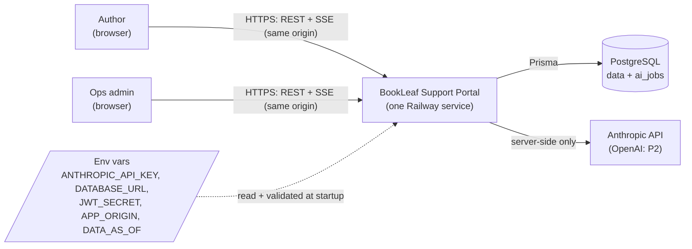

The browser never talks to an AI provider and never receives any part of an API key.

---

## 2. Runtime parts (one Node process)

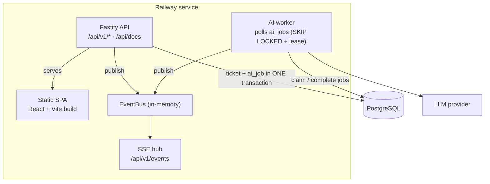

The worker only depends on the DB and the `EventBus` interface, so it can move to its own process
later. More than one instance would switch `EventBus` to Postgres `LISTEN/NOTIFY` (deferred).

---

## 3. Layers inside the API

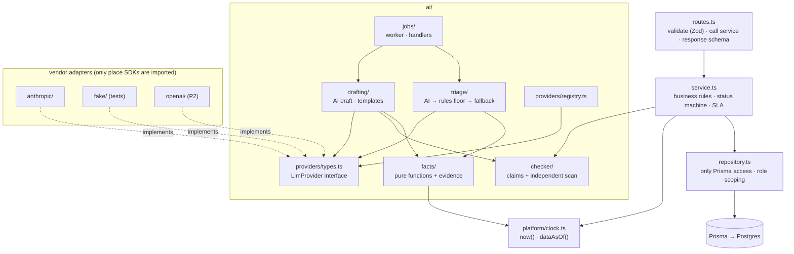

ESLint rules: routes never import Prisma; services never import Fastify; vendor SDKs only in their
adapter folder; no `Date` construction outside `clock.ts`. Wiring happens once in `container.ts`.

---

## 4. Ticket lifecycle

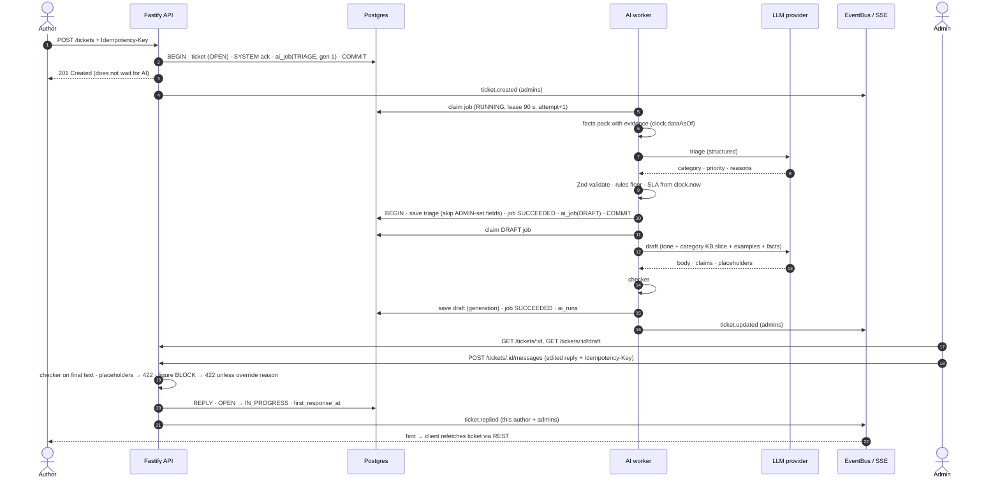

---

## 5. AI job states, retries and recovery

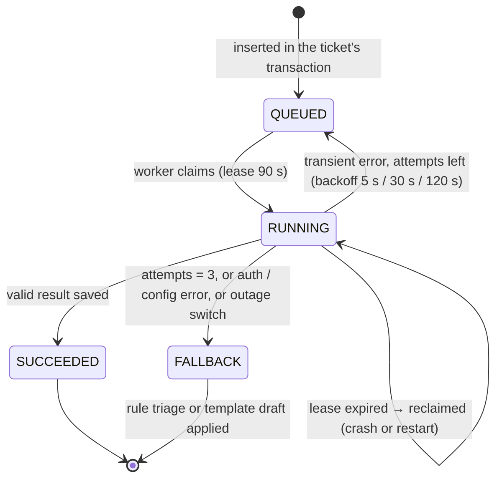

Every exit leaves the ticket with a category, a priority, an SLA and a usable draft. "Retry AI" or
"Regenerate" creates a new job with `generation + 1`; stale generations never overwrite newer results.

---

## 6. AI pipeline per job

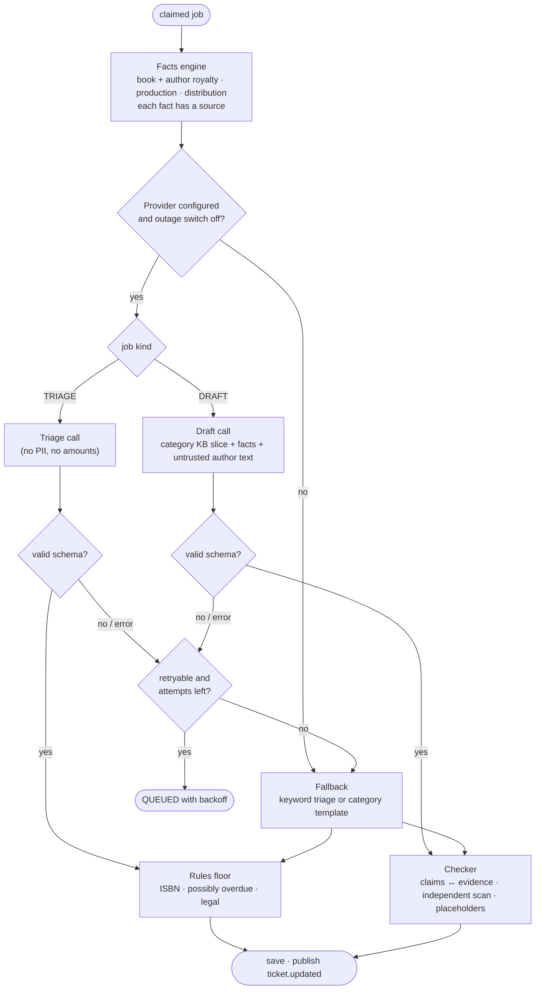

---

## 7. AI configuration

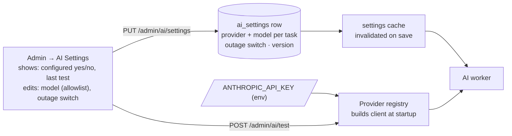

Keys come only from env. The UI can choose among providers whose key is present and models from a
server-side allowlist; it can never read or write a key.

---

## 8. Realtime and reconnection

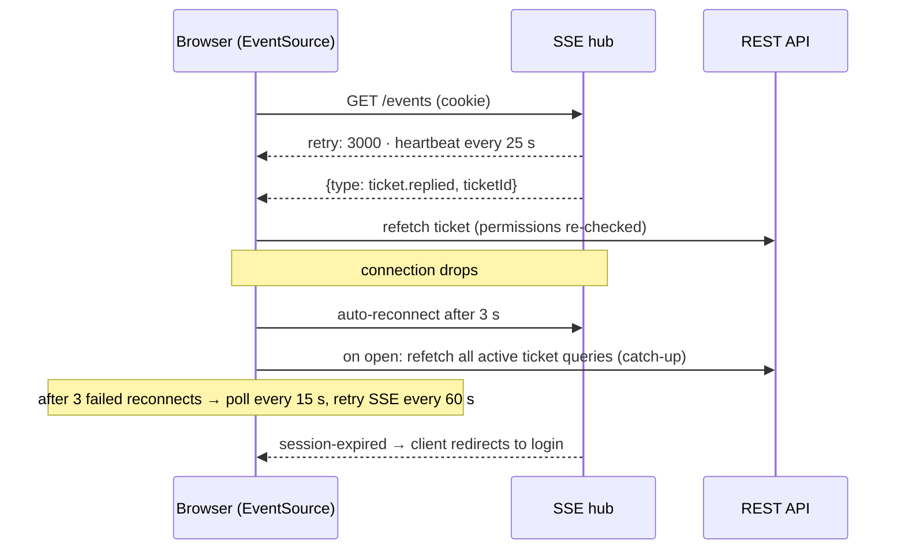

Events carry only `{ type, ticketId }`, so a missed or duplicated event cannot lose or leak data.

---

## 9. Data model

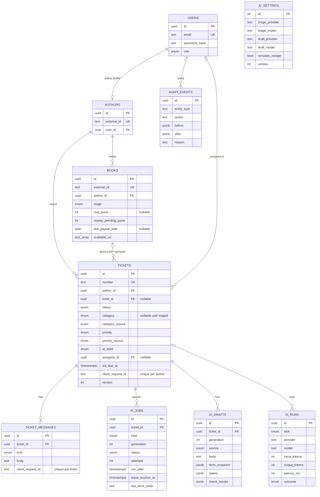

Indexes: `tickets (status, priority, sla_due_at)` for the queue; `tickets (author_id, created_at)`;
`ticket_messages (ticket_id, created_at)`; `ai_jobs (status, run_after)`; `books (author_id)`.
Unique: `ai_jobs (ticket_id, kind, generation)`, `tickets (author_id, client_request_id)`,
`ticket_messages (ticket_id, client_request_id)`.

---

## 10. Ticket status machine

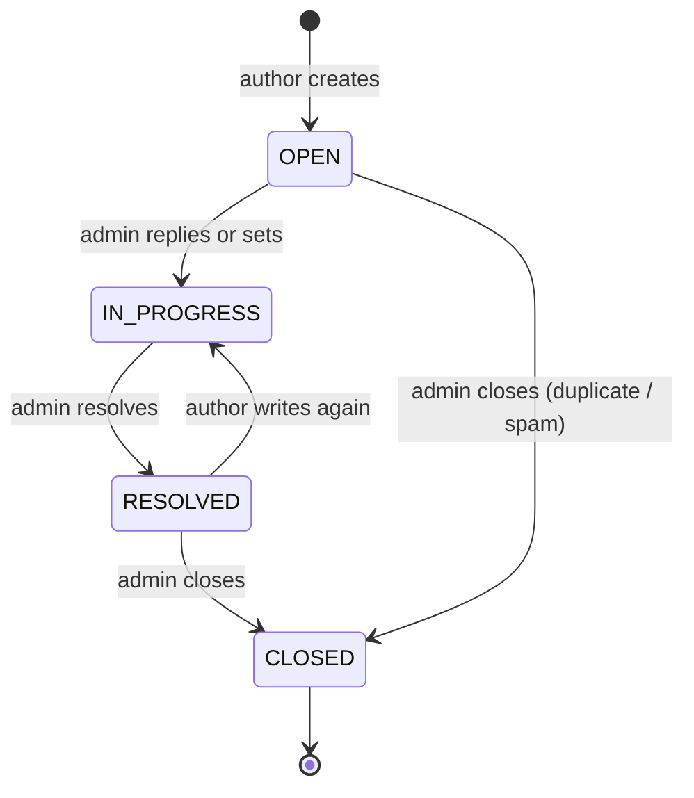

Any other transition → `409 INVALID_STATUS_TRANSITION`.

---

## 11. Access control

| Resource | Author | Admin |
| --- | --- | --- |
| Own books, tickets, public messages | read · create tickets and messages | read · write |
| Another author's books or tickets | **404** (existence not revealed) | read · write |
| Internal notes, drafts, evidence, AI status, category, priority, assignee | never in author responses or author SSE events | read · write |
| AI settings and status | 403 | read · write (no key access, ever) |

Role and author id come only from the verified session. Role scoping lives in repositories; response
shapes are separate Zod schemas per role, so undeclared fields are stripped.

CSRF: SameSite=Lax cookie + Origin must equal `APP_ORIGIN` on state-changing requests + JSON-only
bodies. No CORS headers.

---

## 12. Shared business services (all channels)

Phase 1 builds these services for admin drafting. Phases 2 and 3 add new **channels** on top; they
add no new data paths.

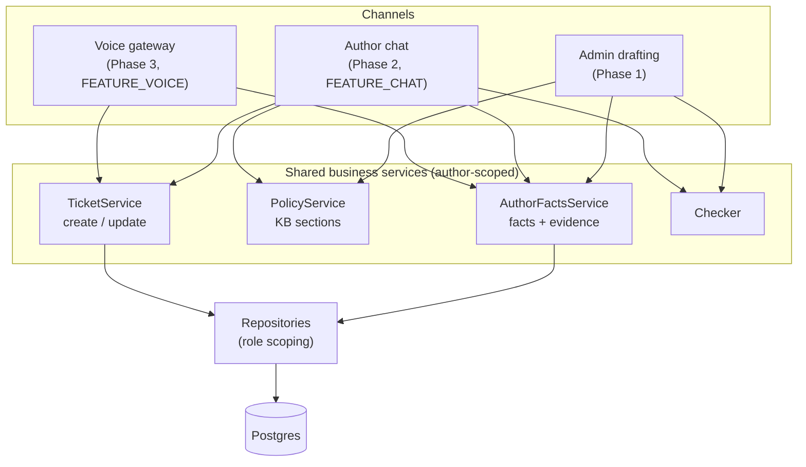

Author identity always comes from the BookLeaf session. No channel accepts an author id from a
model, a browser body or a third-party platform.

---

## 13. Phase 2 — AI chat

```mermaid
sequenceDiagram
    autonumber
    actor A as Author
    participant API as Chat API
    participant CS as Chat service
    participant LLM as LLM provider
    participant T as Assistant tools
    participant CK as Checker
    participant TS as TicketService

    A->>API: POST /chat/sessions/:id/messages
    API->>CS: authorId from session
    CS->>LLM: prompt + last turns + tool schemas
    LLM-->>CS: tool call get_book_royalties(BK001)
    CS->>T: run with authorId (bookId ownership checked)
    T-->>CS: facts + evidence
    CS->>LLM: tool result
    LLM-->>CS: answer text
    CS->>CK: scan answer vs facts from this turn + KB constants
    alt passes
        CS-->>A: answer
    else blocked (after one retry)
        CS-->>A: safe reply + "raise a ticket?"
    end
    A->>API: confirm ticket proposal (Idempotency-Key)
    API->>TS: create ticket (source CHAT, chat_session_id)
    TS-->>A: ticket number; normal triage + draft follow
```

---

## 14. Phase 3 — Voice: integration boundary with Vocal

**Vocal** is a separate product (repo `Loop Methods/voice_agent`, QA at `verbi.si`). BookLeaf uses
it as an external platform, configured but not modified.

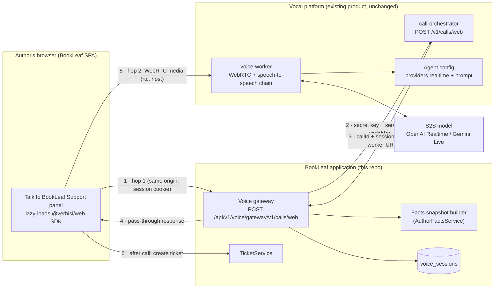

| Side | Owns |
| --- | --- |
| BookLeaf | Author login and identity, facts snapshot, voice gateway, `voice_sessions` audit rows, rate limits, UI states, tickets |
| Vocal | Agent definition (S2S provider, model, voice, prompt), call control, WebRTC media, the S2S model connection, call records |
| Boundary contract | One server-to-server request (`POST /v1/calls/web` with a `vak_` key and `variables`), and the SDK's media hop. Nothing else crosses |

### Call start

```mermaid
sequenceDiagram
    autonumber
    actor A as Author
    participant UI as Voice panel
    participant GW as BookLeaf voice gateway
    participant F as AuthorFactsService
    participant V as Vocal call-orchestrator
    participant W as Vocal voice-worker
    participant M as S2S model

    A->>UI: Talk to BookLeaf Support
    UI->>GW: GET /voice/status (flag, configured, reachable, hours)
    UI->>UI: mic permission
    UI->>GW: SDK start() → POST {baseUrl}/v1/calls/web (cookie)
    GW->>GW: check session + Origin; drop client variables/metadata/webhookUrl/agentId
    GW->>F: facts snapshot for this author (≤ 8 KB)
    GW->>V: POST /v1/calls/web (vak_ key, agentId from env, variables = snapshot)
    V-->>GW: callId, sessionToken, worker URL
    GW->>GW: insert voice_sessions (author, callId, snapshot hash)
    GW-->>UI: same response
    UI->>W: WebRTC offer + sessionToken
    W->>M: open S2S session (prompt rendered with snapshot)
    A->>M: "How much royalty is pending?"
    M-->>A: spoken answer from the snapshot (also shown on screen)
```

Failure handling: status check fails → panel shows "Voice support unavailable" with ticket/chat
links; `microphone-denied` → explain how to allow it; reconnecting → shown; call ends after
5 minutes (fits Vocal's 300 s session token); any error stays inside the panel's error boundary.

### Phase 3b (deferred): live tools inside the S2S call

Not possible by configuration today: Vocal's speech-to-speech chain registers only `end_call`;
HTTP tools run only on cascade flow agents. The target, if Vocal is extended:

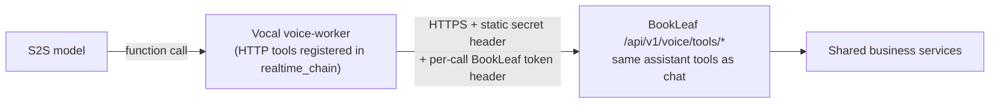
