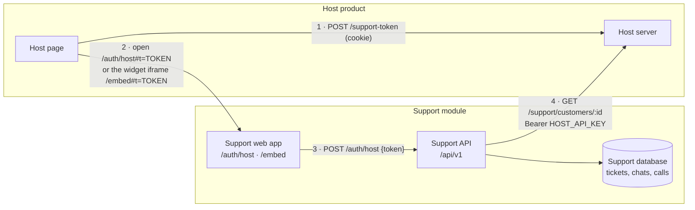

# Attaching BookLeaf Support to a product

The support module (tickets, AI replies, chat, voice and history) runs on its own, with its own
database. It does not store the product's customer data. It asks the product (the **host**) for it
over HTTP whenever it needs it.

To attach it, the host does three things:

1. **Signs its user in** to support with a short-lived token.
2. **Serves one endpoint** that describes a customer.
3. **Shows support** to its users: a link, a script tag, or a Fastify plugin.

`apps/host-demo` is a working example of all three. It is a small stand-in for BookLeaf's own
product.



---

## 1. Settings on the support side

All settings live in `apps/api/src/config/host.ts` and are checked when the app starts.

| Setting | Example | What it is |
| --- | --- | --- |
| `HOST_API_URL` | `https://app.example.com` | Base URL of the host server |
| `HOST_API_KEY` | 24+ random characters | Sent as `Authorization: Bearer …` on every customer request |
| `HOST_SIGNING_SECRET` | 32+ random characters | Shared HS256 secret for sign-in tokens |
| `HOST_SIGN_IN_URL` | `https://app.example.com/login` | Where "Sign in" sends a customer who has no session |
| `HOST_ORIGINS` | `https://app.example.com` | Turns on embed mode (see step 3b). Empty means off |
| `HOST_TIMEOUT_MS` | `3000` | How long to wait for the host |
| `HOST_CACHE_SECONDS` | `60` | How long one customer answer is reused |

Generate each secret with `openssl rand -base64 48`. Keep the same values on the host side.

---

## 2a. Sign the customer in

When a customer opens support, the host **server** makes a token signed with HS256 using
`HOST_SIGNING_SECRET`:

| Claim | Rule |
| --- | --- |
| `sub` | The customer's id in the host (1–100 characters) |
| `name`, `email` | Shown to support staff |
| `aud` | Must be `"support"` |
| `jti` | A new random id for every token (8–100 characters). Each token signs in **once** |
| `iat`, `exp` | `exp` may be at most **300 seconds** after `iat` |

```ts
// Node, with `jose`. This is what apps/host-demo/src/tokens.ts does.
const token = await new SignJWT({ name, email })
  .setProtectedHeader({ alg: 'HS256' })
  .setSubject(customerId)
  .setJti(randomUUID()) // from node:crypto
  .setAudience('support')
  .setIssuedAt()
  .setExpirationTime('300s')
  .sign(new TextEncoder().encode(process.env.HOST_SIGNING_SECRET));
```

The browser then opens `{SUPPORT_URL}/auth/host#t={token}`. The token is in the URL **fragment**,
which browsers never send to a server, so it never appears in server logs. The support page
exchanges it at `POST /api/v1/auth/host` for its own session cookie.

- A host token always signs in a **customer** (role `AUTHOR`). Support staff sign in on the support
  login page with a password, so a host can never create an admin.
- A token is refused (401) when it is expired, has the wrong audience, lives longer than 300
  seconds, or was already used. An email that belongs to a staff account is refused with 409.
- Customer and item ids may use letters, digits and `. _ @ : -`, but may not be `.` or `..`. An item
  already linked to another customer is never moved (409).
- Used token ids are remembered in memory until they expire, because support runs as one instance.
- On sign-in, support stores only a reference to the customer: the external id, name and email,
  plus each item's id and title. Everything else is read live (step 2b).

## 2b. Serve the customer endpoint

```
GET {HOST_API_URL}/support/customers/{id}
Authorization: Bearer {HOST_API_KEY}
```

Return 404 for an unknown id. Otherwise return the JSON below. Support checks every response against
`HostCustomerSchema` in `packages/shared/src/schemas/host.ts`.

```json
{
  "id": "AUTH001",
  "name": "Priya Sharma",
  "email": "priya.sharma@email.com",
  "facts": [
    { "id": "author.total_pending", "label": "Total royalty pending", "type": "MONEY",
      "value": 357000, "display": "₹3,570",
      "source": { "kind": "DERIVED", "rule": "sum of pending royalty", "inputs": [], "assumptions": [] } }
  ],
  "details": [{ "label": "Total pending", "display": "₹3,570" }],
  "items": [
    { "id": "BK001", "title": "Whispers of the Ganges",
      "facts": [ "…facts about this book only…" ],
      "details": [{ "label": "ISBN", "display": "978-93-5XXXX-01-1" }] }
  ]
}
```

- **`facts`** are for the assistant. Each one has a type, a value and a `source`: a record field, a
  knowledge-base rule, a calculation, or `MISSING` when the host does not know. The AI may only state
  numbers and dates that appear in facts. The answer checker blocks anything else.
- **`details`** are lines the customer sees on the *My Books* page, shown as they are.
- `items` are what the customer has with the host. For BookLeaf these are books. Tickets can point
  at one item.

The parts of the module written for BookLeaf look for these fact ids
(`packages/shared/src/fact-ids.ts`). Other fact ids are passed to the assistant unchanged.

| Fact id | Type | Used for |
| --- | --- | --- |
| `author.total_pending` | MONEY | Payout answers |
| `author.payout_eligibility` | STATUS: `ELIGIBLE` / `NOT_ELIGIBLE` | Threshold answers, reply templates |
| `payout.next_cycle_deadline` | DATE | "When will I be paid?" |
| `book.{id}.royalty_pending` | MONEY | Per-book answers |
| `book.{id}.royalty_status` | STATUS: `NOTHING_PENDING` / `BELOW_THRESHOLD` / `POSSIBLY_OVERDUE` / `SCHEDULED` | Triage priority floor, templates |
| `book.{id}.stage` | STATUS | Production questions |
| `book.{id}.isbn` | TEXT | ISBN questions |

**If the host is slow or down:** support waits `HOST_TIMEOUT_MS`, never caches the failure, and the
assistant receives one fact, `host.records_unavailable`. It then tells the customer it cannot see
their records right now and offers to raise a ticket. Tickets, chat and history keep working.

---

## 3. Show support to your users (pick one)

### a. A link (no setup)

A button that calls your token endpoint and opens `{SUPPORT_URL}/auth/host#t={token}` in a new tab.
This is what host-demo's *Open support in a new tab* button does (`apps/host-demo/public/page.js`).

### b. The widget (one script tag)

```html
<script src="{SUPPORT_URL}/embed.js" data-token-url="/support-token" defer></script>
```

- `data-token-url` is an endpoint on **your** origin. It answers `POST` (with your session cookie)
  with `{ "token": "…" }`.
- The script draws a *Help* button. Opening it asks your endpoint for a fresh token and shows
  `{SUPPORT_URL}/embed#t={token}` in a panel. It also has *open in a new tab* and *close*.
  `window.BookLeafSupport.open()` and `.close()` are there if you want your own button.
- Set `HOST_ORIGINS` to your page origins. Then:
  - only `/embed` may be framed, and only by those origins;
  - `/embed.js` may be loaded from other sites;
  - the session cookie becomes `SameSite=None; Secure; Partitioned`, so it works inside the iframe
    and is kept separate from other sites. This applies to every session on that deployment,
    including staff. To keep staff on `SameSite=Lax`, run a second deployment for staff without
    `HOST_ORIGINS`.
- Writes are still protected by the `Origin` check, which does not depend on cookie settings.
- If a browser blocks the cookie in the iframe, *open in a new tab* still works.

### c. Inside a Node (Fastify) server

```ts
import { loadEnv, supportPlugin } from '@bookleaf/api';

await app.register(supportPlugin, { prefix: '/support', env: loadEnv() });
// → /support/api/v1/… and /support/health
```

Under a prefix, the plugin serves the **API only**. The web app, the widget and the
`/auth/host` link expect support at the root of an origin, so for those, mount the plugin with no
prefix on its own host name (for example `support.example.com`), or run the standalone server.

The plugin is encapsulated. Its security headers, cookies, rate limits, error format and routes stay
under the prefix, and the host's own routes are untouched (`apps/api/test/plugin.int.test.ts`). It
starts the AI worker when the app is ready and stops it when the app closes.

---

## Detaching

- Remove the link or the script tag. Nothing else on the host page depends on it.
- Stop the support service. The host keeps working; it only loses the support pages.
- To move to another support system, export the support database. Customer records were never
  copied into it beyond the reference rows described in step 2a.

## Using it for a product other than BookLeaf

The engine is generic. These parts describe BookLeaf's business and would be replaced:

| Part | File |
| --- | --- |
| Knowledge base and reply examples | `apps/api/src/ai/prompts/kb.ts`, `examples.ts` |
| Ticket categories and labels | `packages/shared/src/enums.ts`, `labels.ts` |
| Triage rules (priority floor, keywords) | `apps/api/src/ai/triage/rules.ts`, `fallback-classifier.ts` |
| Reply templates used when AI is off | `apps/api/src/ai/drafting/templates.ts` |
| Royalty signals read from facts | `apps/api/src/ai/domain/signals.ts` |
| Quick answers in chat | `apps/api/src/ai/chat/quick/` |
| The fact ids above | `packages/shared/src/fact-ids.ts` |

Webhooks to the host (for example "ticket replied") are not built. They would be a small addition in
`apps/api/src/host/`.
