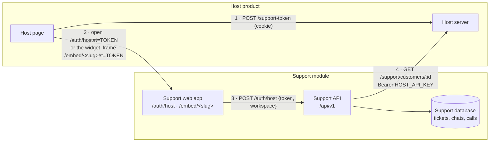

# Attaching BookLeaf Support to a product

The support module (tickets, AI replies, chat, voice and history) runs on its own, with its own
database. It does not store the product's customer data. It asks the product (the **host**) for it
over HTTP whenever it needs it.

To attach it, the host does three things:

1. **Signs its user in** to support with a short-lived token.
2. **Serves one endpoint** that describes a customer.
3. **Shows support** to its users: a link, a script tag, or a Fastify plugin.

`apps/host-demo` is a working example of all three. It is a small stand-in for BookLeaf's own
product.



---

## 1. Settings on the support side

All settings live in `apps/api/src/config/host.ts` and are checked when the app starts.

| Setting | Example | What it is |
| --- | --- | --- |
| `HOST_API_URL` | `https://app.example.com` | Base URL of the host server |
| `HOST_API_KEY` | 24+ random characters | Sent as `Authorization: Bearer …` on every customer request |
| `HOST_SIGNING_SECRET` | 32+ random characters | Shared HS256 secret for sign-in tokens |
| `HOST_SIGN_IN_URL` | `https://app.example.com/login` | Where "Sign in" sends a customer who has no session |
| `HOST_ORIGINS` | `https://app.example.com` | Turns on embed mode (see step 3b). Empty means off |
| `EMBED_ENABLED` | `true` | Embed mode without `HOST_ORIGINS`: each workspace lists its own page origins under **Settings → Widget**. Each workspace's widget page (`/embed/<slug>`) sends only that workspace's origins in `frame-ancestors` (plus `HOST_ORIGINS` for the default workspace, BookLeaf). Only plain `http(s)://host[:port]` origins are accepted |
| `HOST_TIMEOUT_MS` | `3000` | How long to wait for the host |
| `HOST_CACHE_SECONDS` | `60` | How long one customer answer is reused |

Generate each secret with `openssl rand -base64 48`. Keep the same values on the host side.

---

## 2a. Sign the customer in

When a customer opens support, the host **server** makes a token signed with HS256 using
`HOST_SIGNING_SECRET`:

| Claim | Rule |
| --- | --- |
| `sub` | The customer's id in the host (1–100 characters) |
| `name`, `email` | Shown to support staff |
| `aud` | Must be `"support"` |
| `jti` | A new random id for every token (8–100 characters). Each token signs in **once** |
| `iat`, `exp` | `exp` may be at most **300 seconds** after `iat` |

```ts
// Node, with `jose`. This is what apps/host-demo/src/tokens.ts does.
const token = await new SignJWT({ name, email })
  .setProtectedHeader({ alg: 'HS256' })
  .setSubject(customerId)
  .setJti(randomUUID()) // from node:crypto
  .setAudience('support')
  .setIssuedAt()
  .setExpirationTime('300s')
  .sign(new TextEncoder().encode(process.env.HOST_SIGNING_SECRET));
```

The browser then opens `{SUPPORT_URL}/auth/host#t={token}`. The token is in the URL **fragment**,
which browsers never send to a server, so it never appears in server logs. The support page
exchanges it at `POST /api/v1/auth/host` for its own session cookie.

- A host token always signs in a **customer** (role `AUTHOR`). Support staff sign in on the support
  login page with a password, so a host can never create an admin.
- A token is refused (401) when it is expired, has the wrong audience, lives longer than 300
  seconds, or was already used. An email that belongs to a staff account is refused with 409.
- Customer and item ids may use letters, digits and `. _ @ : -`, but may not be `.` or `..`. An item
  already linked to another customer is never moved (409).
- Used token ids are remembered in memory until they expire, because support runs as one instance.
- On sign-in, support stores only a reference to the customer: the external id, name and email,
  plus each item's id and title. Everything else is read live (step 2b).

## 2b. Serve the customer endpoint

```
GET {HOST_API_URL}/support/customers/{id}
Authorization: Bearer {HOST_API_KEY}
```

Return 404 for an unknown id. Otherwise return the JSON below. Support checks every response against
`HostCustomerSchema` in `packages/shared/src/schemas/host.ts`.

```json
{
  "id": "AUTH001",
  "name": "Priya Sharma",
  "email": "priya.sharma@email.com",
  "facts": [
    { "id": "author.total_pending", "label": "Total royalty pending", "type": "MONEY",
      "value": 357000, "display": "₹3,570",
      "source": { "kind": "DERIVED", "rule": "sum of pending royalty", "inputs": [], "assumptions": [] } }
  ],
  "details": [{ "label": "Total pending", "display": "₹3,570" }],
  "items": [
    { "id": "BK001", "title": "Whispers of the Ganges",
      "facts": [ "…facts about this book only…" ],
      "details": [{ "label": "ISBN", "display": "978-93-5XXXX-01-1" }] }
  ]
}
```

- **`facts`** are for the assistant. Each one has a type, a value and a `source`: a record field, a
  knowledge-base rule, a calculation, or `MISSING` when the host does not know. The AI may only state
  numbers and dates that appear in facts. The answer checker blocks anything else.
- **`details`** are display lines shown as they are. The support API returns them from
  `GET /api/v1/books`. The support web app no longer has a *My Books* page, so the host shows its
  own books and figures in its own pages (BookLeaf does this on its dashboard).
- `items` are what the customer has with the host. For BookLeaf these are books. Tickets can point
  at one item.

The parts of the module written for BookLeaf look for these fact ids
(`packages/shared/src/fact-ids.ts`). Other fact ids are passed to the assistant unchanged.

| Fact id | Type | Used for |
| --- | --- | --- |
| `author.total_pending` | MONEY | Payout answers |
| `author.payout_eligibility` | STATUS: `ELIGIBLE` / `NOT_ELIGIBLE` | Threshold answers, reply templates |
| `payout.next_cycle_deadline` | DATE | "When will I be paid?" |
| `book.{id}.royalty_pending` | MONEY | Per-book answers |
| `book.{id}.royalty_status` | STATUS: `NOTHING_PENDING` / `BELOW_THRESHOLD` / `POSSIBLY_OVERDUE` / `SCHEDULED` | Triage priority floor, templates |
| `book.{id}.stage` | STATUS | Production questions |
| `book.{id}.isbn` | TEXT | ISBN questions |

**If the host is slow or down:** support waits `HOST_TIMEOUT_MS`, never caches the failure, and the
assistant receives one fact, `host.records_unavailable`. It then says it could not confirm the answer
from the customer's records, does not guess, and offers to raise a ticket. Tickets, chat and history
keep working.

---

## 3. Show support to your users (pick one)

### a. A link (no setup)

A button that calls your token endpoint and opens `{SUPPORT_URL}/auth/host#t={token}` in a new tab.
The route still exists in the support app. The BookLeaf dashboard itself uses the widget (b), not a
link.

### b. The widget (one script tag)

```html
<script
  src="{SUPPORT_URL}/embed.js"
  data-workspace="bookleaf"
  data-token-url="/support-token"
  data-theme="auto"
  defer
></script>
```

Each workspace has its own widget address, `{SUPPORT_URL}/embed/<slug>` (the slug is the
workspace's address name, chosen at signup). Only that workspace's allowed origins may frame it.

**Tag attributes** (read at the top of `apps/web/public/embed.js`):

| Attribute | Required | Default | What it does |
| --- | --- | --- | --- |
| `data-workspace` | yes (new tags) | none | Your workspace's slug, e.g. `bookleaf`. The frame opens `/embed/<slug>`. A value that is not a slug makes the script throw an error. Without it (tags written before F-18) the frame opens the old `/embed`, which redirects to the default workspace (BookLeaf) |
| `data-token-url` | yes | none | An endpoint on **your** origin. It answers `POST` (with your session cookie) with `{ "token": "…" }`. Without it, the script throws an error |
| `data-label` | no | `Help` | Text on the launcher button |
| `data-title` | no | workspace brand name + "Help" | Title in the panel header. Without it, the panel shows the workspace's brand name (set in Settings → Widget), and the launcher takes the brand colour |
| `data-theme` | no | `auto` | `light`, `dark` or `auto`. See "Theme" below. Any other value means `auto` |

**What the script does**

- It draws a launcher button (bottom right). Opening it asks `data-token-url` for a fresh token
  and shows the support app in an iframe inside a panel, at
  `{SUPPORT_URL}/embed/<slug>#t={token}&theme=…`.
  The iframe is allowed to use the microphone (`allow="microphone"`), which voice needs.
- The panel header has **Expand** and **Close**. Expand makes the panel fill the page (with a
  margin of 24 px on wide screens, edge to edge on narrow ones) and dims the page behind it. The
  user never leaves the host page and no new tab opens. The same button collapses it again. `Esc`
  steps back: full screen, then the docked panel, then closed.
- `window.BookLeafSupport` has `open()`, `close()`, `expand()` and `collapse()` if you want your
  own buttons. `expand()` opens the panel first if it is closed.
- Remove the tag and the widget is gone. Nothing else needs to be undone.

**The token hand-over.** The token travels in the iframe address as `#t=…`, the URL fragment, so it
is never sent to a server or logged. The support app reads it and exchanges it at
`POST /api/v1/auth/host` for its own session cookie, sending the slug from its own address
(`{ token, workspace }`). The token's workspace (its `iss` claim; no `iss` means the default
workspace) must be that slug, or the server refuses with **403** before the token is used up, so a
token can never start a session inside another workspace's widget. A token works once (`jti`), so
every time the panel opens, or the app asks to sign in again, the script fetches a new one.

**Theme.** The frame follows the host page, in both directions of time:

- `data-theme="light"` or `"dark"` fixes the theme. `auto` (the default) follows the host page:
  class `dark` or `light` on `<html>`, or `data-theme="dark"` or `"light"` on `<html>`. If the page
  says nothing, the visitor's system setting is used (`prefers-color-scheme`).
- The script paints the launcher and the panel frame with that theme. It also passes it to the
  support app in the frame address (`#theme=dark`), so the first paint is already right.
- When the host switches theme later, a `MutationObserver` on `<html>` (and the system setting)
  tells the frame with a `postMessage`: `{ type: "bookleaf-support:theme", theme: "light" | "dark" }`.
  The frame is not reloaded. The support app accepts the message only from its parent window and
  only the two values `light` and `dark`.

**Messages from the frame to the host page.** The support app sends these with `postMessage`
(`apps/web/src/lib/frame.ts`). They carry no secrets.

| `type` | Extra field | Meaning | What `embed.js` does |
| --- | --- | --- | --- |
| `bookleaf-support:reauth` | `path` | The session ran out | Fetches a new token and reloads the frame on `path`. `path` must be this workspace's page (`/embed/<slug>` or `/embed/<slug>/...`), else `/embed/<slug>` is used. At most 3 times per minute, then it shows "Please close help and open it again." |
| `bookleaf-support:escape` | none | The user pressed `Esc` inside the frame | Steps back as above |
| `bookleaf-support:expand` | none | Ask the host to go full screen | Calls `expand()` |
| `bookleaf-support:close` | none | Ask the host to close the panel | Calls `close()` |

`embed.js` accepts a message only when **both** are true: `event.origin` equals the support app's
origin (taken from the script's own `src`), and `event.source` is the frame's own window. Anything
else is ignored. Only types that start with `bookleaf-support:` are read.

**Screens inside the frame.** Only these paths may be framed, and only by that workspace's origins
(`HOST_ORIGINS` plus Settings → Widget for BookLeaf; Settings → Widget for any other workspace):

| Path | Screen |
| --- | --- |
| `/embed/<slug>` | Home |
| `/embed/<slug>/ask` | Ask: chat, with the voice button |
| `/embed/<slug>/tickets` · `…/tickets/new` · `…/tickets/:id` | Tickets, new ticket, one ticket |
| `/embed/<slug>/history` · `…/history/:kind/:id` | History, one past chat or call |

An unknown slug answers **404**. The old shared address keeps working: `/embed` redirects (302) to
`/embed/bookleaf`, and `/embed/ask`, `/embed/tickets/…` and `/embed/history/…` to the same page
under `/embed/bookleaf`. The browser keeps the `#t=…` token across the redirect. For that reason
`ask`, `tickets` and `history` cannot be chosen as workspace slugs.

**Server settings for the widget.** Set `HOST_ORIGINS` to your page origins (comma-separated). Then:

- only `/embed/<slug>` and the pages under it may be framed, and only by that workspace's origins
  (`HOST_ORIGINS` counts for the default workspace only);
- the API serves the widget page itself (it needs the web build, `WEB_DIST_DIR`), because the
  framing rule comes from the database. When the web app is hosted elsewhere (Vercel in the demo),
  that host must forward `/embed` and `/embed/*` to the API; see [deploy.md](deploy.md);
- `/embed.js` may be loaded from other sites, and is revalidated on every page load, so a new
  version reaches users without a hard refresh;
- the session cookie becomes `SameSite=None; Secure; Partitioned`, so it works inside the iframe
  and is kept separate from other sites. This applies to every session on that deployment,
  including staff. To keep staff on `SameSite=Lax`, run a second deployment for staff without
  `HOST_ORIGINS`.
- Writes are still protected by the `Origin` check, which does not depend on cookie settings.
- If a browser blocks the cookie in the iframe, open `{SUPPORT_URL}/auth/host#t={token}` in a new
  tab instead (link, option a).

#### Voice calls from the widget

The chat box in **Ask** has a voice button. The call is part of the conversation in the chat. The
browser starts it with:

```
POST /api/v1/voice/calls
{ "resume": false, "chatSessionId": "<uuid>" }     // both fields optional
```

- Without `chatSessionId`, the call is a separate thread. `resume: true` continues the author's last
  dropped call (within 60 minutes, same conversation and ticket draft).
- With `chatSessionId`, the call **joins that chat**. It hears the chat so far, shares the chat's
  ticket draft, and when it ends its lines are saved into the chat as messages with
  `channel: "VOICE"` and the `callId` of the call. Typed messages have `channel: "CHAT"`. In
  History the call appears inside the chat, not as a second conversation. `resume` is ignored when
  `chatSessionId` is given.
- `404` if the chat does not exist or belongs to another author.
- `409` with code `CHAT_TURN_LIMIT` if the chat has already used all its messages.
- **One limit for both.** Each question the author speaks counts as one message, like a typed one.
  `CHAT_MAX_TURNS_PER_SESSION` (default 30) is the limit. When the author speaks the last allowed
  question, the assistant still answers it, says a short goodbye, and the call ends with reason
  `TURN_LIMIT`. If the answer takes more than 25 seconds the call is ended anyway. The chat box
  then becomes a card with **New conversation**.
- Other errors: `503 VOICE_UNAVAILABLE` (voice off or no key), `429` (calls per hour or per day).
- The audio then runs over a WebSocket at the `socketPath` the response returns. The response is
  `{ id, socketPath, maxSeconds, connectWithinSeconds }`.

### c. Inside a Node (Fastify) server

```ts
import { loadEnv, supportPlugin } from '@bookleaf/api';

await app.register(supportPlugin, { prefix: '/support', env: loadEnv() });
// → /support/api/v1/… and /support/health
```

Under a prefix, the plugin serves the **API only**. The web app, the widget and the
`/auth/host` link expect support at the root of an origin, so for those, mount the plugin with no
prefix on its own host name (for example `support.example.com`), or run the standalone server.

The plugin is encapsulated. Its security headers, cookies, rate limits, error format and routes stay
under the prefix, and the host's own routes are untouched (`apps/api/test/plugin.int.test.ts`). It
starts the AI worker when the app is ready and stops it when the app closes.

The plugin needs two database URLs (row-level security, S.8): `DATABASE_URL` for the restricted
app role every request runs on, and `DATABASE_ADMIN_URL` for the owner (migrations, signup,
sign-in lookups, the worker). Run `prisma migrate deploy` and then `node dist/db-roles.js` (or
`pnpm db:roles`) with both set before the first start; it creates the app role from the user and
password in `DATABASE_URL`. In production the plugin refuses to start when the roles are wrong.

---

## Detaching

- Remove the link or the script tag. Nothing else on the host page depends on it.
- Stop the support service. The host keeps working; it only loses the support pages.
- To move to another support system, export the support database. Customer records were never
  copied into it beyond the reference rows described in step 2a.

## Many products on one support service (workspaces)

The service hosts one **workspace** per business. A business signs up at `/signup`, then configures
everything in **Workspace settings** (admin area) instead of env:

| Screen | What it sets | API |
| --- | --- | --- |
| Product Connection | the base URL of the customer endpoint (step 2b), the Bearer API key, the HS256 signing secret, sign-in URL, timeout, cache; a **Test** button fetches one customer | `GET/PUT /api/v1/workspace/connector`, `POST …/connector/test` |
| Customer Data | the fields the product sends (key, label, type, meaning for the assistant, status codes, visible to customer) | `/api/v1/workspace/fields` |
| Workspace Settings | models per job, tone guide, chat and voice switches and limits, voice name, widget origins, branding, nouns | `GET/PUT /api/v1/workspace/settings` |
| API Keys | server-to-server keys, shown once, revocable | `/api/v1/workspace/api-keys` |
| Provider Keys | the workspace's own AI and voice provider keys (write-only, last 4 shown) | `/api/v1/workspace/provider-keys` |
| Webhooks | URLs told about `ticket.created`, `ticket.replied`, `ticket.status_changed`; signing secret shown once; test delivery; last 20 deliveries | `/api/v1/workspace/webhooks` |

**Platform settings stay with the platform operator.** The platform AI provider, its models and
the outage switch (`/admin/ai/*`) apply to every workspace, so only admins of the default workspace
can see or change them; other workspaces get 403 and choose their own models in Workspace
Settings. Every admin read is limited to the admin's own workspace: chat transcripts, call
transcripts, tickets, and the live event stream.

Secrets are encrypted at rest (AES-256-GCM under the server's `SECRETS_MASTER_KEY`) and never
returned; the screens show a last-4 hint only.

**Server API (workspace API keys).** Your server reads its own tickets with a key that has the
`tickets:read` scope: `Authorization: Bearer blsk_…`.

| Route | Returns |
| --- | --- |
| `GET /api/v1/server/tickets?status=&updatedSince=&cursor=&limit=` | newest first, `limit` 1–200 (default 50), `nextCursor` for the next page |
| `GET /api/v1/server/tickets/:id` | the ticket and its conversation (author messages, replies, system notes; never internal notes) |

Tickets use your own ids: `customerId` is the customer id your product sends, and `itemId` is the
item id (book), or `null` for account-level tickets. Errors: 401 for a missing, unknown or revoked
key, 403 for a missing scope, 404 for another workspace's ticket. Limit: 120 requests per minute.

**Customer data on the staff ticket page (U-1).** The ticket page's Customer panel shows the
record your product sends for the customer: the account `details` and each item's `details` first,
then the facts your customer data fields describe (Customer data page), under the field's label and
in the field's order. A per-item field (`book.{id}.status`) is matched to each item by its id, and a
trailing "(per book)" in its label is dropped inside the item. A fact that repeats a line already
shown is left out. With no fields defined, the record's own facts are shown under their own labels
(policy and missing facts excluded). The panel also lists the customer's other tickets in your
workspace. When your product does not answer, the profile and tickets still show.

**Solved tickets are locked for the customer (U-2).** Once a ticket is Resolved or Closed, the
customer can no longer write on it: `POST /tickets/:id/messages` from the customer answers
`409 TICKET_SOLVED`, and the widget offers "Raise a new ticket" instead. Staff can still reply and can
reopen it from the ticket page.

**Webhooks.** Each event is saved in the same database transaction as the change (an outbox), then
POSTed as JSON: `{ "id", "type", "createdAt", "data": { "ticket", "message"? } }`. Headers:
`X-BookLeaf-Event`, `X-BookLeaf-Delivery` (the same id on every retry, so you can drop duplicates)
and `X-BookLeaf-Signature: t=<unix seconds>,v1=<hex>`. To check a delivery:

1. Compute HMAC-SHA256 of `"<t>.<raw body>"` with the signing secret.
2. Compare it to `v1` in constant time.
3. Refuse it if `t` is more than 5 minutes old.

Any 2xx answer counts as delivered. Otherwise the delivery is retried 6 times in total, with
backoff from 30 s doubling, plus jitter. Redirects are not followed. The receiving address must
pass the same checks as connector URLs, and it is checked again at every send.

**Sign-in tokens name the workspace.** Add the claim `iss: "<workspace id>"` (the slug chosen at
signup, e.g. `acme`) to the token from step 2a and sign it with the secret saved in Product
Connection. A token without `iss` belongs to the default `bookleaf` workspace and is verified with
`HOST_SIGNING_SECRET` from env, so the BookLeaf demo keeps working unchanged.

Connector URLs are checked before use: https only in production, and no address that resolves to a
loopback, private, link-local or metadata range (development override `CONNECTOR_ALLOW_PRIVATE_HOSTS`).

Design, data model and roadmap: [`saas/PLAN.md`](saas/PLAN.md).

## Using it for a product other than BookLeaf

The engine is generic. These parts describe BookLeaf's business and would be replaced:

| Part | File |
| --- | --- |
| Ticket categories and knowledge base | Per workspace, in the staff app (Categories, Knowledge Base); API `/api/v1/workspace/categories`, `/api/v1/workspace/knowledge`. BookLeaf's seed: `apps/api/src/modules/categories/bookleaf-knowledge.ts` |
| Reply examples (BookLeaf only) | `apps/api/src/ai/prompts/examples.ts` |
| Triage rules (priority floor; BookLeaf's keywords) | `apps/api/src/ai/triage/rules.ts`, `fallback-classifier.ts` (other workspaces: `word-match.ts`) |
| Reply templates used when AI is off (BookLeaf only; others get a generic one) | `apps/api/src/ai/drafting/templates.ts` |
| Royalty signals read from facts | `apps/api/src/ai/domain/signals.ts` |
| Quick answers in chat | `apps/api/src/ai/chat/quick/` |
| The fact ids above | `packages/shared/src/fact-ids.ts` |

Webhooks to the host (for example "ticket replied") are not built. They would be a small addition in
`apps/api/src/host/`.
