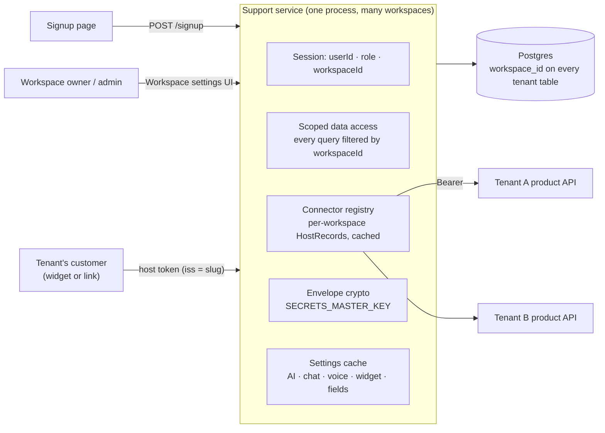

# Multi-tenant SaaS platform — plan

> Turns the single-customer support module into a product many businesses can sign up to and
> configure entirely from the UI. BookLeaf becomes workspace #1, seeded from today's env values.
> Branch `feature/saas-platform`. Companion docs: `docs/architecture.md`, `docs/integration.md`.

---

## 1. Goal and principles

- **Any business signs up**, gets a workspace, and configures the product in the browser: how we
  fetch their customer data, what that data looks like, ticket categories, knowledge base, AI
  models and tone, chat and voice limits, widget origins and branding, API keys.
- **Nothing tenant-specific in env.** Env holds only platform secrets (database, session signing,
  the secrets master key, AI vendor keys the platform pays for). Everything else is a row.
- **A customer is a customer**, not an author. Items are "items", facts are whatever the tenant
  defines. BookLeaf's authors and books are one tenant's vocabulary, seeded as data.
- **Isolation first.** Every tenant-owned row carries `workspace_id`; every query is scoped by the
  signed-in session's workspace; Postgres RLS is the second lock (built in S.8, see §5.2).
- **Additive.** New modules under `modules/workspaces`, `modules/connectors`, `modules/settings`,
  `platform/crypto`. Existing files get the smallest edits that make them workspace-aware.

## 2. Research notes (Context7 + vendor patterns)

| Topic | What we took |
| --- | --- |
| Prisma + RLS (`/websites/prisma_io`, client extensions) | Prisma recommends one extended client per request that wraps queries in `$transaction` and runs `SET LOCAL app.tenant_id` first. Pooled connections make a plain `SET` unsafe. Built (S.8): the extension sets `app.workspace_id` per query transaction from an `AsyncLocalStorage` scope (§5.2). |
| Envelope encryption | AES-256-GCM. A random 32-byte data key per secret encrypts the value; the data key is wrapped with the master key (`SECRETS_MASTER_KEY`, base64, ≥ 32 bytes). Stored as `v1.<keyId>.<wrappedDek>.<iv>.<tag>.<ciphertext>`. Rotation = new master key id, re-wrap data keys only (no re-encryption of values). AAD binds the ciphertext to `workspaceId:field`, so a ciphertext cannot be moved between rows. |
| Zendesk / Intercom / Freshdesk / Gorgias | All share: **workspace (account/subdomain)** → **members with roles** (owner / admin / agent) → **custom fields** on tickets and on the customer ("user attributes", "custom objects") → **data connectors / apps** that pull records from the customer's own system → **API keys per workspace** with scopes → **webhooks** → **audit log**. Ticket *forms* (which fields are shown) and *SLA policies* sit on top of categories and priorities. We model the same shapes in domain words, not vendor words. |
| Embedded widget identity (Intercom identity verification) | Intercom: `user_hash = HMAC-SHA256(secret, user_id)`; or a JWT signed with the workspace secret. We already use a short-lived HS256 JWT (`aud: support`, `jti` single-use). Multi-tenant addition: the token carries `iss: <workspace slug>` so the server can find the right signing secret; a token without `iss` belongs to the default (env) workspace. |
| SSRF (OWASP) | Tenant-supplied connector URLs: https only in production, resolve DNS and refuse loopback, private, link-local, multicast and metadata ranges, no redirects (`redirect: 'error'` already set), short timeout, response size cap. Dev override `CONNECTOR_ALLOW_PRIVATE_HOSTS=true`. |

## 3. Target architecture



**Tenant resolution.** The session cookie carries `workspaceId`. Staff get it from their user row at
login. Customers get it from the host token: `iss` names the workspace slug; the server loads that
workspace's signing secret (decrypted) and verifies the token with it. No `iss` → default workspace,
verified with `HOST_SIGNING_SECRET` from env (today's BookLeaf behaviour, unchanged).

**Config resolution order** (per workspace): workspace row → platform default (env or constant).
The default workspace `bookleaf` has no rows of its own until someone edits it in the UI, so it
behaves exactly as today.

## 4. Data model

| Table | Purpose | Key columns |
| --- | --- | --- |
| `workspaces` | The tenant | `slug` (unique, 3–40, `[a-z0-9-]`), `name`, `is_default` |
| `workspace_members` | Who may administer it | `workspace_id`, `user_id`, `role` OWNER / ADMIN / AGENT; unique per (workspace, user) |
| `workspace_connectors` | How we fetch customer data | `base_url`, `api_key_enc`, `api_key_hint`, `signing_secret_enc`, `signing_secret_hint`, `sign_in_url`, `timeout_ms`, `cache_seconds`, `last_test_at`, `last_test_ok`, `version` |
| `customer_fields` | The tenant's customer-data schema (fact definitions) | `key` (e.g. `account.total_pending`, `item.{id}.status`), `label`, `type` MONEY / DATE / TEXT / STATUS / NUMBER, `description` (shown to the AI), `allowed_values` (STATUS), `visible_to_customer`, `position` |
| `workspace_settings` | Per-workspace switches and limits | AI: `triage_model`, `draft_model`, `chat_model`, `tone_guide`, `system_prompt_extra`; chat: `chat_enabled`, `messages_per_minute`, `messages_per_day`, `max_turns`; voice: `voice_enabled`, `voice_name`, `max_call_seconds`, `calls_per_hour`, `calls_per_day`; widget: `allowed_origins[]`, `brand_name`, `brand_color`, `customer_noun`, `item_noun`; `version` |
| `ticket_categories` | Tenant categories (S.9, built) | `key` (UPPER_SNAKE_CASE, unique per workspace, fixed once created), `label`, `description` (for triage), `default_priority`, `sla_hours` (nullable; the sooner of it and the priority's target wins), `position`, `is_active`. Deactivated, never deleted; the last active one cannot be deactivated |
| `knowledge_articles` | Knowledge base (S.9, built) | `title`, `body`, `position`, `is_active`; links in `knowledge_article_categories (workspace_id, article_id, category_key)`, both foreign keys include `workspace_id`. Drafts get only the active articles linked to the ticket's category; chat/voice get every active article |
| `tickets.category_key`, `ticket_drafts.category_key` | Link to the workspace category (S.9) | FK `(workspace_id, category_key)` → `ticket_categories`; backfilled from the old enum `category`, which stays unused until a later release drops it |
| `workspace_api_keys` | Server-to-server keys | `name`, `prefix` (shown), `key_hash` (sha256), `scopes[]`, `last_used_at`, `revoked_at` |
| `audit_events` (existing) | Config and ticket changes | + `workspace_id` |
| existing tenant tables | `users`, `authors`, `books`, `tickets`, `chat_sessions`, `voice_sessions`, `ticket_drafts` | + `workspace_id` (required after backfill) |

Uniqueness moves under the workspace: `users (workspace_id, email)`,
`authors (workspace_id, external_id)`, `books (workspace_id, external_id)`.

The singleton `ai_settings` / `assistant_settings` rows stay as **platform defaults**; a
`workspace_settings` row overrides them. Dropping the singletons is a later contract step.

## 5. Security model

### 5.1 Tenant isolation (application layer, tonight)

- `Session.workspaceId` is signed into the cookie; nothing from the client (headers, query, body)
  ever selects a workspace.
- `ownership(session)` in `modules/tickets/repository.ts` — the one place ticket visibility is
  decided — adds `workspaceId`. Author-scoped queries are already bound to an `authorId` that lives
  inside one workspace.
- Admin settings routes read `sessionOf(req).workspaceId`; they never take a workspace id as input.
- Integration test: workspace B's admin asks for workspace A's ticket → 404; B's list never contains
  A's rows; B's signup cannot reuse A's slug.

### 5.2 Row-level security (built: S.8)

Migration `20261030130000_row_level_security`:

```sql
CREATE FUNCTION app_current_workspace_id() RETURNS uuid LANGUAGE sql STABLE AS
  $$ SELECT NULLIF(current_setting('app.workspace_id', true), '')::uuid $$;
ALTER TABLE tickets ENABLE ROW LEVEL SECURITY;
ALTER TABLE tickets FORCE ROW LEVEL SECURITY;
CREATE POLICY workspace_isolation ON tickets
  USING (workspace_id = app_current_workspace_id())
  WITH CHECK (workspace_id = app_current_workspace_id());
-- the same on workspace_members, workspace_connectors, customer_fields, workspace_settings,
-- workspace_api_keys, workspace_provider_keys, workspace_webhooks, users, authors, books,
-- ticket_drafts, chat_sessions, voice_sessions, audit_events, ticket_categories,
-- knowledge_articles, knowledge_article_categories; `workspaces` on its own id;
-- ticket_messages, ai_jobs, ai_drafts, ai_runs (ticketless runs allowed), chat_messages and
-- webhook_deliveries through their parent row's workspace_id.
```

- **Two roles.** `DATABASE_URL` is a restricted app role (login, no superuser, no `BYPASSRLS`,
  row access only; `pnpm db:roles` / `node dist/db-roles.js` creates it idempotently from the
  user and password in that URL). `DATABASE_ADMIN_URL` is the owner, which bypasses RLS:
  migrations, the seed, signup, sign-in lookups by email / slug / API key, the AI worker, the
  webhook sender and the startup call clean-up. The API checks both roles at startup (refuses to
  start in production if either is wrong; warns elsewhere).
- **Scope per call, not per connection** (`platform/tenancy.ts`, `platform/tenant-db.ts`). An
  `AsyncLocalStorage` scope says which workspace the current call chain runs as. The auth guard
  runs each signed-in request's handler inside `withWorkspace(session.workspaceId)`; platform work
  runs inside `asPlatform()`. The app's one `Db` picks the connection per call: platform → owner;
  workspace → a Prisma query extension wraps each query in a small transaction that runs
  `SELECT set_config('app.workspace_id', $1, true)` first (Prisma's RLS pattern; pooled-safe), and
  an interactive `$transaction(async (tx) => …)` sets it once as its first statement; no scope →
  nothing is set and tenant tables return no rows (default deny). Batch `$transaction([...])` is
  refused in a workspace scope (it cannot set the workspace first).
- Per-workspace caches (settings, provider keys, connector config and signing secret) always read
  inside their own workspace, whoever asks first. Voice-call callbacks that run later from socket
  or provider events are bound to the caller's workspace.
- F-12's member-removal trigger now runs as its owner (`SECURITY DEFINER`).

### 5.3 Secrets

- `SECRETS_MASTER_KEY`: base64, ≥ 32 bytes, validated at startup, **required in production**.
  Without it (dev), saving a connector fails with 503 `SECRETS_NOT_CONFIGURED`; the env-seeded
  default workspace keeps working.
- Secrets are write-only: responses carry `hint` (last 4) and `updatedAt`, never the value.
- Decrypted values live only in memory inside the connector registry, keyed by workspace and
  invalidated on every save.
- Logs redact `apiKey`, `signingSecret`, `token`, `password` (existing redaction list).

### 5.4 SSRF guard for connector URLs

`platform/net/ssrf.ts`: parse → scheme check (https in production) → DNS resolve all A/AAAA →
reject loopback, RFC1918, CGNAT, link-local (incl. `169.254.169.254`), multicast, unspecified,
IPv4-mapped IPv6 → the fetch keeps `redirect: 'error'` and a 3 s timeout. Dev override
`CONNECTOR_ALLOW_PRIVATE_HOSTS=true` (never in production).

### 5.5 Rate limits per tenant

Existing per-author limits move to `workspace_settings`. Signup: 5 per IP per hour. Connector
test: 10 per workspace per minute. API keys: sha256 hashed, prefix shown, compared in constant time.

## 6. Migration path from env-driven BookLeaf

1. Migration `workspaces` (expand): create `workspaces`, `workspace_members`; add nullable
   `workspace_id` to tenant tables; insert the default workspace `bookleaf`; backfill every row to
   it; set `NOT NULL`; replace global unique indexes with `(workspace_id, …)` ones. One migration,
   runs on an empty and on a populated database, idempotent inserts.
2. `seedCore` upserts the default workspace and makes every seeded admin an OWNER member.
3. The connector registry answers `records(workspaceId)`: a saved connector row wins; the default
   workspace without a row falls back to `HOST_*` env (exactly today's behaviour).
4. Host tokens without `iss` → default workspace. BookLeaf's host-demo keeps working unchanged.
   A tenant's product adds `iss: '<slug>'` to the token.
5. Later (contract): drop `HOST_*` env once BookLeaf's connector row exists; drop the singleton
   settings rows once every reader goes through `workspace_settings`.

## 7. Roadmap

| # | Slice | Tonight | Later |
| --- | --- | --- | --- |
| 1 | Tenancy core: tables, backfill migration, `workspaceId` in session, scoped ticket queries, cross-tenant test; RLS policies + scoped client (§5.2, S.8) | ✅ | |
| 2 | Self-serve signup API + page | ✅ | Email verification, invitations, member management UI |
| 3 | Envelope crypto, connector table, admin endpoints + UI + test-connection, SSRF guard, per-workspace `HostRecords` | ✅ | KMS-backed master key, key rotation job |
| 4 | Customer-data schema (customer fields) API + UI; BookLeaf fields as seed | ✅ API + UI | Fact validation driven by field definitions; triage rules per field |
| 5 | Workspace settings (AI models, tone, chat/voice switches + limits, voice name, widget origins + branding) API + UI | ✅ API + UI | Readers wired (S.7). Categories and KB CRUD replacing the hard-coded enum: ✅ S.9 (category-only selection). Later: RAG with pgvector; generic chat/voice wording for non-BookLeaf workspaces; drop the old `category` enum columns |
| 6 | Generic wording in new surfaces ("customer", "item") | ✅ new surfaces | Rename old routes behind aliases |
| 7 | Workspace API keys + audit log of config changes | ✅ keys + audit + UI | Endpoints that accept the keys, webhooks |

Status per slice is kept in the final hand-over and in `TASKS.md`.
